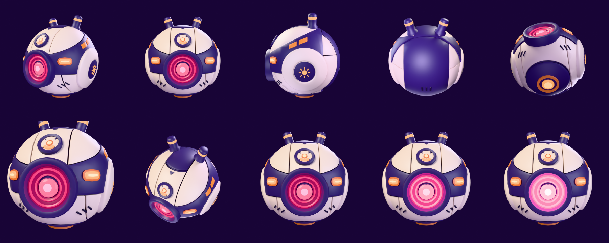

# PR_SecurityDrone

A hovering security drone for LaserHeist. This is the asset only: nothing here is wired into the
game. Built in Blender 5.2 entirely from scripts, from the concept sheet in `ref/`.

**v2 (emissive refinement, 16 Nov 2026)** keeps the approved v1 model and reworks its lights. The
silhouette, armour, proportions and hierarchy are unchanged. Every light is now a core / lens / halo
fixture, set in a three-level brightness order, and the emitter state values live in the master.



## Files

| Path | What |
|---|---|
| `PR_SecurityDrone_master.blend` | Source (v2). Generated by `build/01_build_drone.py`, so edit the script, not the file. The emitter states are its text block `EmitterStates.json`. |
| `exports/PR_SecurityDrone.usdz` | Runtime asset (v2, 564 KB). USDZ, Y up, metres, front +Z. |
| `exports/PR_SecurityDrone_states.json` | Linear emission values for Idle, Charging and Firing, which material sits on which part, and motion suggestions. |
| `archive/v1_approved/` | The approved v1: master, USDZ, states file and the build scripts that made them. |
| `asset-brief.md` | Proportions taken from the concept, the parts list, and what was inferred. |
| `ref/` | The concept sheet and its crops. |
| `review/v2_emissive/` | v2 previews, `concept_sheet.png`, `compare_v1_v2.png`, the round trip, and `realitykit/` renders. |
| `review/v1_approved/` | v1 previews as approved (Standard view transform). |
| `review/v1_approved_neutral/` | v1 re-rendered with v2's settings, for the comparison. |

## Rebuild

Run from this folder, with `B=/Applications/Blender.app/Contents/MacOS/Blender`:

```bash
$B --background --python build/01_build_drone.py -- --out PR_SecurityDrone_master.blend
```

```bash
$B --background PR_SecurityDrone_master.blend --python build/02_review_renders.py -- --out review/v2_emissive --views hero,front_threequarter,front,side,rear,top,bottom,emitter --states --size 900 --samples 96
```

```bash
$B --background PR_SecurityDrone_master.blend --python build/03_export_usdz.py -- --out exports/PR_SecurityDrone.usdz
```

```bash
usdchecker --arkit exports/PR_SecurityDrone.usdz
```

```bash
$B --background --python build/05_verify_usdz.py -- --usdz exports/PR_SecurityDrone.usdz --render review/v2_emissive/roundtrip_threequarter.png
```

```bash
DEVELOPER_DIR=/Applications/Xcode.app/Contents/Developer xcrun swiftc -O -o /tmp/rkcheck build/06_realitykit_check.swift && /tmp/rkcheck exports/PR_SecurityDrone.usdz exports/PR_SecurityDrone_states.json review/v2_emissive/realitykit
```

`build/04_contact_sheet.py` builds the sheets. Review renders use Cycles with the
**Khronos PBR Neutral** view transform. It rolls bright emission off toward white the way a game
renderer's tone mapping does, where Standard clips each channel. The previews use no compositor
and no bloom, so they show only what the USDZ carries.

## Conventions

- **Blender master:** metres, Z up, the drone faces −Y. The origin is the body centre, which is also
  the float and turn pivot.
- **USDZ:** Y up, metres, the emitter toward +Z (the game camera). The axis change is baked into
  the exported geometry and pivots, and every Xform's local axes are the game's own: +Y up, +Z along
  the firing axis, +X to the camera's right.
- **Left and right** are the sides as the camera sees the drone facing it: `Left*` parts are at −X.
- **Size:** the body is 0.60 m across and 0.69 m tall including the antennas. Bounds are
  0.633 × 0.688 × 0.615 m. The scale is inferred from the concept.
- **Geometry:** 41 meshes and 11,984 triangles (v1: 40 meshes and 11,806). There are no UVs and no
  textures, and every surface uses a flat UsdPreviewSurface material.
- **Multi-material parts:** a part with several materials is one mesh with material slots, which
  USD stores as geom subsets. RealityKit loads it as one `ModelEntity` with several materials.

## Light design

Brightness hierarchy, by Idle emission strength:

| Level | What | Core | Lens | Halo |
|---|---|---|---|---|
| 1 | Front emitter | hot centre 3.2 | magenta lens 2.0, rings 1.1 | recess floor 0.40, housing inner wall 0.10 |
| 2 | Radar dial lamp and arc; side lamps | 2.6 | 1.3 | 0.6 |
| 3 | Antenna bands, bottom light, side glyphs | 1.5 | 0.8 | 0.35 |

Paint is not a light. The orange panels are lifted by emission 0.10 and the dial face by 0.10,
which reads as backlit.

**Halos are geometry, not bloom.** Each lamp is a bright core, an amber lens, and a flush rim just
outside the lens with dim emission. The rim plays the falloff a glow would have, and it survives any
renderer.

- **Side lamps:** flatter and sunk into the visor, with a core strip, the lens and a halo rim.
- **Radar dial:** a new `Dial_Lamp` (bright core in a halo collar) at its centre, an emissive arc
  and a faintly backlit face.
- **Antennas:** the bands are nearly flush, with a brighter centre line. The mast slivers just
  above and below each band take the spill.
- **Bottom light:** core centre, lens disc and halo ring.

**Emitter depth**, front to back:

1. Housing rim.
2. Outer ring.
3. Lens dome, with the hot centre as the nearest lit point.
4. Inner ring.
5. Glowing recess floor.

The housing's inner wall carries the spill. The recess hole is narrower (0.050 m), so the lens
fills it.

## Materials

There are 16 materials, with sRGB values as authored. USD `emissiveColor` is the linear colour ×
strength.

| Material | On | Base | Rough | Emission × strength (Idle) |
|---|---|---|---|---|
| M_Ivory | shells, brow, chin, side domes | 0.88 0.81 0.75 | 0.45 | — |
| M_DeepPurple | core, visor, spine, rear, cap, housing, masts, plates, dial ring | 0.20 0.15 0.36 | 0.50 | — |
| M_Orange | accent panels | 0.97 0.55 0.13 | 0.45 | same × 0.10 |
| M_Vent | vents | 0.10 0.07 0.18 | 0.65 | — |
| M_DialFace | radar face | 0.88 0.81 0.75 | 0.40 | 1.00 0.78 0.50 × 0.10 |
| M_EmitterCore | EmitterCore slot 0 (lens) | 0.80 0.12 0.38 | 0.15 | 1.00 0.20 0.50 × 2.0 |
| M_EmitterCoreHot | EmitterCore slot 1 (centre) | 1.00 0.72 0.86 | 0.10 | 1.00 0.55 0.78 × 3.2 |
| M_EmitterRing | both emitter rings | 0.50 0.06 0.24 | 0.30 | 1.00 0.18 0.48 × 1.1 |
| M_EmitterGlow | housing slot 1 (recess floor) | 0.20 0.05 0.18 | 0.40 | 0.95 0.16 0.48 × 0.40 |
| M_EmitterSpill | housing slot 2 (inner wall) | 0.20 0.15 0.36 | 0.45 | 0.90 0.20 0.55 × 0.10 |
| M_IndicatorCore | side lamp core, radar lamp | 1.00 0.92 0.72 | 0.20 | 1.00 0.86 0.55 × 2.6 |
| M_IndicatorLens | side lamp lens, radar arc | 1.00 0.70 0.30 | 0.25 | 1.00 0.62 0.20 × 1.3 |
| M_IndicatorHalo | side lamp rim, radar collar | 0.50 0.28 0.22 | 0.40 | 1.00 0.50 0.14 × 0.60 |
| M_AccentCore | antenna band centre, bottom light centre | 1.00 0.88 0.62 | 0.25 | 1.00 0.80 0.48 × 1.5 |
| M_AccentLight | antenna bands, bottom lens, side glyphs | 1.00 0.74 0.40 | 0.30 | 1.00 0.68 0.30 × 0.8 |
| M_AccentHalo | mast spill, bottom halo ring | 0.50 0.32 0.26 | 0.45 | 1.00 0.55 0.20 × 0.35 |

### Emitter states

Only the five emitter materials change, and base colours stay fixed so the geometry reads at the
peak. Values are emission × strength (sRGB). Linear values are in
`exports/PR_SecurityDrone_states.json`, and the master's `EmitterStates.json` is the single source.

| Material | Idle | Charging | Firing |
|---|---|---|---|
| M_EmitterCore | 1.00 0.20 0.50 × 2.0 | 1.00 0.24 0.55 × 4.5 | 1.00 0.28 0.62 × 8.5 |
| M_EmitterCoreHot | 1.00 0.55 0.78 × 3.2 | 1.00 0.62 0.82 × 8.0 | 1.00 0.88 0.95 × 32 |
| M_EmitterRing | 1.00 0.18 0.48 × 1.1 | 1.00 0.26 0.58 × 4.0 | 1.00 0.34 0.66 × 6.0 |
| M_EmitterGlow | 0.95 0.16 0.48 × 0.40 | 0.95 0.20 0.52 × 1.3 | 0.95 0.28 0.58 × 3.2 |
| M_EmitterSpill | 0.90 0.20 0.55 × 0.10 | 0.90 0.24 0.58 × 0.35 | 0.90 0.30 0.62 × 1.0 |

The Firing peak is concentrated in the small hot centre. The lens stays saturated pink around it,
so the drone's shape survives the peak.

**Applying a state in RealityKit:** set `emissiveColor` to the state's linear colour and
`emissiveIntensity` to its strength on each emitter material. The RealityKit check does this by
finding the materials through their Idle values; production code would keep references to them.

**Motion suggestions** (in the states file; timing stays with the game's clock):

- **Idle:** breathe ±10 % on a 2.4 s sine loop, with the rings turning slowly.
- **Charging:** an ease-in ramp across the warning time, with the rings spinning up.
- **Firing:** reach the peak in 60–80 ms with ease-out, hold, then return to Idle over 250 ms.

## Hierarchy

The hierarchy is unchanged from v1, plus `Dial_Lamp`. Material slots are shown in brackets.

```text
SecurityDrone                    package root (identity)
└── PR_SecurityDrone             DroneRoot: float, bob, turn
    ├── MainBody
    ├── ArmorPanels              Armor_* (14 rigid, detachable panels)
    ├── FrontEmitter             pivot on the firing axis
    │   ├── FrontEmitterHousing  [DeepPurple, EmitterGlow, EmitterSpill]
    │   ├── EmitterRings         spin about local +Z
    │   │   ├── EmitterRing_Outer [EmitterRing]
    │   │   └── EmitterRing_Inner [EmitterRing]
    │   └── EmitterCore          [EmitterCore, EmitterCoreHot]; scale or pulse about its centre
    ├── Left/RightSideModule     Shell, Plate, Glyph [AccentLight]
    ├── Left/RightAntenna        Mast [DeepPurple, AccentHalo], Light [AccentLight, AccentCore]
    ├── AccentLights             AccentLight_L/R [IndicatorLens, IndicatorHalo, IndicatorCore],
    │                            HoverLight [AccentLight, AccentCore, AccentHalo]
    ├── Dial                     Ring, Face [DialFace], Arc [IndicatorLens], Ticks, Marker,
    │                            Dial_Lamp [IndicatorCore, IndicatorHalo]   (new in v2)
    └── Vents
```

## Validation (v2)

| Check | Result |
|---|---|
| `usdchecker --arkit` | **Success** |
| USD API (`05_verify_usdz.py`) | Y up, metres, identity root. 41 meshes, 11,983 triangles. 16 materials bound, including the geom-subset slots. All 11 light materials carry emission, and the emitter slots sit on the parts the states file names. No textures, and orientation and pivots are correct. **PASS** |
| Blender round trip | Same 41 meshes, 11,983 triangles and 16 materials. Render: `review/v2_emissive/roundtrip_threequarter.png` |
| RealityKit, macOS (`06_realitykit_check.swift`) | 41 model entities with 51 material slots, all `PhysicallyBasedMaterial`. Extended-range emissive values arrive intact (core 2.00, hot centre 3.20). Each state updates exactly the 6 emitter material slots. Offscreen non-AR `ARView` renders, without bloom: `review/v2_emissive/realitykit/rk_sheet.png` |

The USD round trip counts 11,983 triangles against 11,984 in Blender because USD drops one
degenerate triangle.

**Level reached:** builds, exports, and renders in RealityKit on macOS. It has not been checked on
an iPad, in the app, or under the game's lighting.

## Limitations

- **No real light from emissive surfaces.** Neither RealityKit nor UsdPreviewSurface lets an
  emissive surface light its neighbours, so all spill is authored as dim emissive geometry. Real
  spill would need a RealityKit `PointLight` on `FrontEmitter`, which costs a dynamic light per
  drone. That is a renderer decision, so it is not in the asset.
- **No bloom.** No bloom is baked or assumed. A soft glow past the lamp edges would need a
  post-process pass in the game renderer, which is a separate presentation decision.
- **Device brightness is untested.** Emission strengths were tuned under PBR Neutral in Cycles and
  checked in macOS RealityKit with default lighting. The game's camera exposure and lighting on
  the iPad may need a global emission scale.
- **Draw calls went up.** Material slots rose from 40 to 51 (one draw call per mesh per material),
  which is fine for a few drones. For a swarm, a delivery variant could merge the halo slots into
  their lens materials.
- **Detached armour is single-sided** (unchanged from v1): render debris double-sided.
- **Concept differences** are unchanged from v1. The emitter is now closer to the sheet's deep,
  glowing tunnel, but it is still two rings rather than many fine ones.
