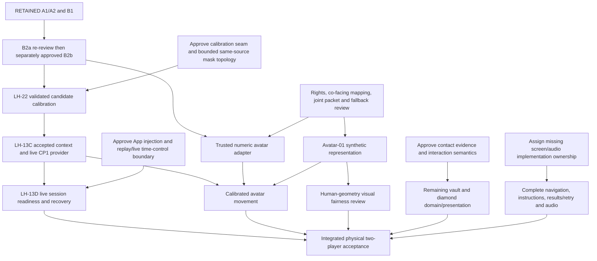

# Laser Heist — Architecture V2: Cutout-to-Avatar Pivot

6 November 2026 · Architecture owner: Edo · Technical review: Kevin and Jevon · Art/UX review: Theo

**Overall disposition: PROPOSED — architecture review only.** The mentor/Tech Lead's representation direction is recorded; this is not approval of the complete revised architecture, code extraction, collision changes, B2a acceptance, B2b implementation or task redistribution.

**Source-verified correction — 6 November 2026 (Kevin, Claude Code audit):** updates §2.1/§2.4/§4/§7/§18.1 for the current spike (`b130d5a`: final orange mascot, arm head-clearance envelope, avatar lighting, foot planting), the unmerged LH-18 vault presentation branch, user-reported physical single-player feasibility and the board's LH-24. The authority split, retained contracts and every PROPOSED/BLOCKED label are unchanged; no decision is accepted by this correction. Package-level detail lives in the [Technical Workplan V2](LaserHeist-Technical-Workplan-V2.md) and the owner/order overlay in [Final Subtask Review V3](LaserHeist-Final-Subtask-Review-V3.md).

**Source-grounded refinement — 6 November 2026.** Incorporates the Current Architecture Baseline Audit in the review conversation and a fresh inspection of current source/contracts. That audit is not a new repository artifact. This revision clarifies composition, joint capabilities, lifecycle/calibration seams, visual fairness and full-product planning inputs. It authorizes documentation only; no owner sign-off or implementation acceptance is inferred.

Decision labels:

- **RETAINED:** accepted existing architecture/contract; implementation status is reported separately.
- **PROPOSED:** recommended, pending the identified owner review.
- **SUPERSEDED:** earlier design goal replaced by the revised direction; code/contracts are not retroactively deleted or invalidated.
- **DEFERRED:** intentionally postponed beyond this revision.
- **BLOCKED:** dependent work requires the named unresolved prerequisite.

## 1. Executive summary and mentor-driven change

**SUPERSEDED — cutouts as the primary intended player representation.** Humans remain physical controllers facing the iPad. The game should display two rear-view 3D avatars facing down the corridor toward hazards, avoiding the old front-facing camera-body appearance.

**RETAINED — human-motion input and authority.** Keep CameraPipeline, bounded FrameStore, B1 Vision extraction, stable association, validated calibration and human-body gameplay evidence. Avatar joints, smoothing, IK and RealityKit contacts do not determine HIT/CLEAR. Camera/Vision remains upright and unmirrored; avatar mapping requires explicit agreement.

**PROPOSED — Option B:** selectively adopt reviewed rig/solver/retargeting concepts from the spike. Exclude its alternative capture, greedy identity, approximate calibration/jump evidence and Rendering-owned live session. Preserve App/Games/Shared and existing targets.

**BLOCKED — production avatar activation** until mapping, fairness, asset rights, pose handoff and live lifecycle/input prerequisites are resolved. Separately authorized synthetic Avatar-01 can establish a representation candidate without pretending live gameplay is ready.

## 2. Current architecture assessment

### 2.1 Verified branch and references

| Reference | Observed state |
|---|---|
| Active branch / HEAD | `feat/architecture`, `5070c0431b8c3fda6a0a0882e667e2b967edc09c` |
| Accepted baseline | `origin/staging`, same `5070c0431b8c3fda6a0a0882e667e2b967edc09c` |
| Divergence | **0 ahead / 0 behind the available `origin/staging` ref**; no fetch or new remote freshness claim in this refinement |
| Avatar source | Available `origin/spike/front-facing-avatar`; first pinned at `6cd062680e5967778125f2b87c01bd189e461229`, current `b130d5a` (§2.4) |
| Vault presentation | `origin/feat/lh18-vault-presentation`, `665b06c`; implemented and tested, unmerged (no PR, not in `staging`) |
| Current architecture tip | `feat/architecture` `7cab612` = this document plus the workplan, Avatar-01 and five empty `Rendering/Avatar/` placeholder Swift files over `5070c04` |
| Tracking source | Available `feat/player-tracking` / `origin/feat/player-tracking`, `69860cc75d820c76c3ac45cfac09edce651892f7`; inspected as Git objects |
| Spike merge base | `9ea77feead299fbf932fb0170ce244f4d03f3f87`; spike predates B1 merge |
| Refinement entry local changes | Modified `Docs/Architecture/Game-Oriented-Architecture.md`; untracked Avatar-01, this V2 document and `Scripts/CP2Spike/`. Preserve all; no staged or local signing changes observed |

The previous Front-Facing Avatar Spike Review exists in the conversation; do not invent a checked-in report path. The local [Avatar-01 proposal](Avatar-01-Rear-View-Representation-Architecture-Proposal.md) is untracked at entry and preserved. Its baseline table describes its earlier tracking-branch design pass, not this checkout. Branches are inspected using Git objects, never switched or merged.

### 2.2 Source audit — file presence is not implementation

Paths in this table are relative to `Sedactive/` unless otherwise stated. Brace notation groups actual verified filenames; bare filenames in the same cell share the immediately preceding directory.

| Component / source | Actual staging state | Architectural implication |
|---|---|---|
| `App/AppDependencies.swift`, `App/RootView.swift` | Retained DEBUG camera/diagnostics composition; ContentView opens PlayView | No complete production live/replay composition or game-first navigation |
| `Shared/BodyTracking/Capture/CameraPipeline.swift`, `FrameStore.swift`, `CameraCaptureMetrics.swift`, `CameraDiagnosticPreview.swift` | Implemented accepted A1/A2 foundation | Reuse ownership, bounds and optional preview |
| `Shared/BodyTracking/Capture/PoseEstimator.swift`, `CameraPoseResults.swift` | Implemented accepted B1; synchronous worker-local inference, eight retained candidates plus original total count, exact source envelope | Reuse raw extraction and publication gates |
| `Shared/BodyTracking/Models/{PoseFrame,BodyGeometry,BodySnapshot,BodyInputProviding,PlayerCalibration}.swift`, `Shared/Players/Player.swift` | Implemented anonymous CP1 values/contracts | Preserve canonical evidence and session-scoped P1/P2 |
| `Shared/BodyTracking/ReplayBodyInput.swift` | Implemented deterministic provider/context/stream behavior | Preserve replay and fixtures |
| `Shared/BodyTracking/Processing/PlayerTracker.swift` | Skeleton here; implemented pure core only on the inspected tracking ref | **B2a READY FOR RE-REVIEW**, not accepted, merged here or live-integrated |
| `Shared/BodyTracking/Processing/{MotionEngine,CalibrationSession,BodyMeasurementExtractor,JumpDetector}.swift`, `Shared/BodyTracking/BodyInputService.swift` | Skeletons | Motion orchestration, real calibration, measurements/jump and live provider are unfinished |
| `Shared/BodyTracking/Capture/PersonSegmenter.swift` | Skeleton | No implemented live/calibration segmentation algorithm |
| `Shared/BodyTracking/Capture/PlayerCutout{Frame,Compositor,Handoff}.swift` | Implemented CPU packet, bounded copy/budget and lease handoff | Does not imply live masks/association exist |
| `Games/LaserHeist/Rendering/{CutoutTextureStore,LiveCutoutPresenter,PlayerCutoutEntity}.swift` | Implemented cutout consumer/rendering; synthetic feed exists | Retain capability during prospective deprecation |
| `Games/LaserHeist/Rendering/{GameWorldMapping,LaserScene,GameplayScenePresenter}.swift`, `Games/LaserHeist/UI/PlayView.swift` | Implemented corridor/game presentation and replay RealityView host | Virtual render camera is not a live camera source; no production avatar path |
| `Games/LaserHeist/Session/GameSessionCoordinator.swift`, `Shared/GameRuntime/GameClock.swift` | Replay-driven coordinator and active-time clock implemented | Live binding/calibration/recovery flow is not completed by replay |
| `Games/LaserHeist/Domain/{LaserGame,LaserCollisionJudge,LaserWaveDirector}.swift` | Implemented state, scheduling, bounded evidence selection and collision | Preserve authoritative Jevon logic/tests |

Historical architecture prose about import-only cameras, profiles or paused work is not current source evidence. A1/A2/B1 reports establish their scoped acceptance; the tracking-ref report establishes only B2a's current re-review status. No new build, compiler, test or physical result is claimed in this revision.

### 2.3 Actual architecture versus proposed integration

**RETAINED — game-oriented modular monolith.** App/Games/Shared are logical boundaries in the existing app module, with a separate `SedactiveTests` target and the existing local RealityKitContent package. The project uses Swift 5 language mode, default MainActor isolation and approachable concurrency; a Swift 6 compiler does not imply Swift 6 language mode or a project-wide complete-concurrency gate. Do not change those settings for this pivot.

| Concern | Actual current branch | V2 target / missing bridge |
|---|---|---|
| Startup | `SedactiveApp` → `ContentView` in `App/RootView.swift` → `PlayView`; DEBUG diagnostics cover | **PROPOSED:** App selects the input dependency; complete Home/Setup/Calibration navigation separately |
| Live input | Real capture → bounded reconstruction → B1 → latest numeric diagnostics; optional independent DEBUG image preview | **BLOCKED:** trusted live association, real calibration/measurements and live CP1 publication |
| Gameplay | `GameSessionCoordinator.start` constructs ReplayBodyInput, claims its stream and advances LaserGame from a script | **PROPOSED:** inject the existing provider contract into that same coordinator; preserve replay driving separately (§5.2) |
| Player visual | Replay pictograms and optional synthetic CP2 images; real texture upload/presentation components | **PROPOSED:** rear-view avatar; no avatar source/assets are present here |
| Game progression | Domain rules, replay slice, vault commands and test-only full-round harness | **BLOCKED:** live phases/contact evidence, diamond collection and other product delivery gaps (§18.3) |

The three current flows—camera/Vision diagnostics, replay gameplay and synthetic CP2 rendering—are separate. Do not draw them as a completed live cooperative pipeline. A skeleton or missing integration is a delivery gap unless a concrete conflicting authority/dependency is identified. ResultsView and retry already work for replay; they are not entirely absent.

Read this audit with [TEAM_ALIGNMENT](TEAM_ALIGNMENT.md), [CP1](LH-00-Checkpoint-1-Contract-Proposal.md), [CP2](LH-00-Checkpoint-2-Cutout-Handoff-Proposal.md), [LH-13's dependency boundaries](LH-13-Live-Camera-Architecture-Proposal.md), [A2 acceptance](LH-13A2-Debug-Preview-Implementation-Report.md), [B1 acceptance](LH-13B1-Raw-Vision-Pose-Implementation-Report.md), and [current gameplay/recovery rules](LaserHeist-Gameplay-Rules.md). The B2a report/source are read from the pinned tracking ref, not assumed to exist in this branch's working tree.

### 2.4 Pinned spike findings

The spike's commits (`5e457dd`, `77901ce`, `6cd0626`, and since then `b130d5a`) add 47 files and change three from the merge base (`PlayView`, `LaserScene`, `GameplayScenePresenter`, all DEBUG-gated). Two groups:

- **Reusable representation POC (production adaptation candidates):** the final colour-corrected orange mascot (`Rendering/Avatar/Robot/mascot.usdz`, sha1 `61d0a911…a2d3ec`, 20 joints, 1.398 m; it replaced the earlier blue robot and an interim pilot mech), bind-derived RobotSkeleton/RobotPoseSolver two-bone IK, RobotRetargeter/RobotAvatarLayer (two independent clones, one shared 1.6 m size, co-facing anatomical mapping, crouch/jump/arms/lean), `MascotPoseEnvelope` arm head-clearance, PoseSmoothing, RobotFootPlanner (planted/stepping/airborne feet, lateral steps), avatar-only lighting and DEBUG demo/replay hosts, with synthetic tests including real-mesh arm-clearance and foot-planting metrics.
- **Alternative live stack (excluded):** the Live Avatar Lab creates its own `CameraPipeline` instance with a custom LivePoseSink running its own Vision request, plus LiveIdentity (greedy P1/P2), LiveCalibrator, LiveSampleBuilder/LiveJumpDetector and LiveGameSession with its own GameClock. In `-liveGame` DEBUG mode it feeds its own BodySnapshots into LaserGame/LaserCollisionJudge — a second CP1 producer and session — despite a stale file comment saying otherwise. None of this group is adopted.

**User-reported physical feasibility (not production acceptance):** Kevin reports testing the live avatar and DEBUG gameplay on a physical iPad with one player, observing JUMP/DUCK behaviour, and reporting movement-quality problems. This is user-reported single-player feasibility through the excluded lab stack. Two-player tracking, full-game stability, end-to-end latency, frame time and thermals are **not** verified.

**PROPOSED extraction:** see [Avatar-01 §2](Avatar-01-Rear-View-Representation-Architecture-Proposal.md#2-exact-extraction-list-and-resource-gate) for exact paths and adaptations. No source tree copying. Staging-only B1/replay files absent from the old spike are not approved deletions.

**BLOCKED asset copy:** the orange mascot declares 20 joints, 1.398 m height, +Y up/−Z forward, +X anatomical right; spike import tests check these on the real asset. Its Codex package (`LaserHeist-Original-Mascot-3D-Color`: compatibility report, skeleton map, colour audit) derives from the team's Asset 13 artwork; that is technical provenance, not a complete rights/distribution/attribution record. Kevin/Theo/Edo must record rights before extraction (WP-D08). No legal clearance is inferred.

## 3. What remains valid

| ID | Status | Decision |
|---|---|---|
| R1 | **RETAINED** | Lean App/Games/Shared logical modules, one app target and separate root test target |
| R2 | **RETAINED** | One retained capture owner/session, bounded raw storage and one processing consumer; no mutable CV/VN transfer |
| R3 | **RETAINED** | Original generation/epoch/sequence/host-clock capture time/geometry and upright unmirrored canonical values |
| R4 | **RETAINED** | Anonymous slots, explicit binding, frame-local candidateIDs; uncertainty cannot silently swap people; B2a implementation review remains open |
| R5 | **RETAINED** | CP1 validity, bounded gameplay stream, separate latest cache and independent status, one gameplay consumer |
| R6 | **RETAINED** | Independent standing references, one shared human scale and full-replacement/revision/cutover contracts; no profile/name/weight/role requirement |
| R7 | **RETAINED** | Jevon owns GameClock, session/readiness, evidence selection, rules, health and score |
| R8 | **RETAINED** | Renderer-independent collision; invalid required evidence is UNAVAILABLE, never automatic HIT or CLEAR |
| R9 | **RETAINED** | Existing regression and CP2 resource-safety evidence; representation change does not erase completed work |

Retaining a contract does not implement the corresponding live skeleton. The raw camera/Vision pipeline is operational; calibrated live gameplay is not yet a completed end-to-end feature.

## 4. What is replaced, optional or deferred

| Item | Disposition |
|---|---|
| Visible cutouts as primary intended representation | **SUPERSEDED** by the mentor/Tech Lead rear-view avatar direction |
| Existing CP2 packets/copier/leases/textures/renderer | **RETAINED** working historical/optional infrastructure; **DEFERRED** removal/deprecation migration |
| Continuous masks/composition for primary avatar display | **PROPOSED:** no longer a required visual dependency |
| Calibration-specific masks/landmarks | **RETAINED** where needed to validate standing head and independent feet |
| Pictogram/neutral-avatar fallback choice | **PROPOSED**, Kevin/Theo review; not an avatar-created tracking status |
| Spike live camera/tracker/calibration/gameplay adapters | **DEFERRED / excluded** from adoption; accepted owners supply their own reviewed integration |
| Fixed equal-size avatars, arm head-clearance envelope, jump tuning, foot/depth heuristics | **PROPOSED** presentation policies; equal size and the outward-arm envelope are deliberate departures from the player's body that WP-D07 must accept or revise. Spike jump tuning affects only its excluded live stack. Foot planting exists as a POC (WP-K07). Production policy **BLOCKED** by fairness/device review |
| Live skeleton overlays and new image preview route | **DEFERRED**, separately scoped exact-source integration |

These are prospective roles, not code deletion or retroactive contract rejection. In particular, cutting out imagery and estimating crown/sole evidence are different requirements.

## 5. Revised end-to-end architecture

**PROPOSED — one authoritative human-motion chain, two logically separate outputs.** This is a target diagram, not a claim that unfinished components exist.

```text
Physical humans
  → Edo: retained CameraPipeline / native session
  → bounded FrameStore / one worker-owned reconstruction
  → B1 PoseEstimator: raw candidates + original source
  → one PlayerTracker owner: trusted slots or explicit uncertainty
  → worker-local MotionEngine composition
       ├ validated LH-22 reference + measurement/jump processing
       │   → BodyInputService accepted context → CP1 BodySnapshot
       │   → bounded gameplay stream → Jevon's sole consumer
       │   → GameClock mapping → LaserGame / LaserCollisionJudge
       │   → read-only state/events → gameplay scene presentation
       │
       └ SAME source/association + observed joint values/context
           → App-composed game-specific adapter
           → latest-only immutable avatar packet + independent status
           → Kevin: retarget → rig/IK/smoothing → rear-view avatars/fallback

During standing calibration only:
  same captured source → bounded reviewed mask/landmark work → LH-22 candidate result
  (no second camera or FrameStore consumer; not continuous CP2 image production)
```

**RETAINED — authority is one-way.** Rig state cannot update human evidence, association, accepted calibration or game results. Shared cannot import game Rendering. App connects reusable producer values to the game-specific packet.

**PROPOSED — aligned source, independent transport.** Outputs for one capture share original source and player association, but do not need equal cadence or lockstep publication. Avatar delay/replacement cannot block CP1 publication. Raw pose before calibration can support a labeled direction-only diagnostic; it cannot claim measured jump/floor or gameplay readiness.

### 5.1 Two outputs, one source and identity decision

**PROPOSED:** MotionEngine composes the one worker-owned tracker and measurement work; it does not own another AVCaptureSession. Resolve one source-stamped association before either output is built. The reusable internal result contains the original capture envelope, original binding/control revision, the current slot outcomes and their associated raw candidates. Measurements additionally use the authoritative provider's compatible accepted reference snapshot. There is no separate avatar-side tracker or accepted-calibration store.

**PROPOSED source-gated commit:** an accepted-context/control change is an ordered command from its authority into the worker, with a read-only versioned reference snapshot. Stamp source/control/reference versions before processing, stage tracker/measurement results, and commit only if those originals still apply. Recheck again at the MainActor provider/visual publication boundary after suspension; an invalidated result cannot be stamped with a newer context to pass. Worker reference snapshots are derived processing inputs, not another acceptance authority. Rejecting stale publication must not leave stale tentative tracker state committed; this is a B2b/C integration gate, not behavior supplied by today's skeletons.

| Output | Contents and authority | Delivery / refusal |
|---|---|---|
| **RETAINED CP1 gameplay** | Validated human measurements under accepted calibration → BodyInputService → existing `BodyInputProviding` / BodySnapshot | Preserve CP1's configured bounded buffer, consumer claim, context/cutovers and independent status. Jevon is the only gameplay reader. Invalid measurements remain explicit. |
| **PROPOSED avatar** | Trusted association + original same-source anatomical joints + presentation-compatible source/control/reference context → AvatarPoseFrame | Separate latest-only bounded numeric handoff; one pending and one current pair. Drop/replace visual work without waiting for renderer loading, IK or frame updates. |

Both paths preserve capture time; publication time is a separate diagnostic. Gameplay must not wait for a texture, avatar, display cadence or presentation acknowledgement. Avatar publication must not drain or delay the CP1 stream. Keep independently bounded admission/drain work; no per-frame Tasks or unbounded producer-to-MainActor queue. Do not copy the avatar's latest-only policy into CP1 or silently change CP1 completion-order/highest-compatible-cache semantics.

An ordered source/control/context invalidation reaches both consumers independently of frames. A bounded internal producer tee supplies the avatar seam and provider state; it is not another CameraPipeline observer claim, FrameStore consumer, CP1 status observer or CP1 gameplay subscriber. The existing diagnostics model already claims the camera observer: live composition must explicitly coordinate or tee at that owner boundary, not register a competing observer. Exact internal syntax and budgets require B2b/C interface review; no new public CP1 API is approved here.

### 5.2 Minimum App composition change — one coordinator

**Actual source:** `GameSessionCoordinator` has `init(script:)`, constructs `ReplayBodyInput` in `start`, creates a synthetic-time GameClock at zero, drains fixture delivery times and applies scripted vault/coverage actions. `AppDependencies` currently retains only the DEBUG camera/diagnostics pair. Injecting a provider alone cannot make those replay scheduling assumptions valid for live input.

**PROPOSED minimum change:** App constructs/selects **one `any BodyInputProviding` dependency** and injects it into the existing GameSessionCoordinator. The coordinator strongly retains the selected provider and exclusively owns its gameplay stream/iterator and status subscription. Keep one coordinator/domain/clock per round; do not introduce `LiveGameSession` or select a provider from inside the renderer.

| Dependency / responsibility | Construction and retention | Runtime authority |
|---|---|---|
| Replay provider | Edo-owned App composition constructs ReplayBodyInput from fixture; coordinator retains the injected provider | Same CP1 validation and one gameplay reader; no physical camera starts |
| Replay-only script/driver | App supplies the existing script plus a narrowly scoped replay-driving collaborator/callback for fixture advancement; reuse the existing implementation logic | Deterministic synthetic clock domain, fixture delivery, scripted vault actions and synthetic coverage remain explicitly replay-only. The driver never creates a second domain/clock/reader. No `advance(to:)` requirement is added to BodyInputProviding. |
| Live provider and source bundle | Edo-owned App composition retains the existing CameraPipeline and, when implemented, MotionEngine/BodyInputService referencing it; inject the service as BodyInputProviding | Service executes source control through that retained camera owner. One tracker/accepted context; no camera allocation by a view, coordinator or avatar layer. |
| Session plan and lifecycle | Jevon owns coordinator configuration, readiness, encounter registration/scheduling and request orchestration | Requests provider start/stop and binding/calibration through reviewed Edo control seams; decides countdown/pause/resume/end. A session-supplied fresh generation is installed by an actual source start, not fabricated by PlayerTracker. |
| Clock basis | App selects explicit replay synthetic-time or live Core Media host-time source adapter, with deterministic injection in tests | Jevon anchors/converts capture time and advances the one GameClock. Renderer update signals are not a second time authority. Never use replay elapsed time or wall-clock offset for live capturedAt. |
| Renderer attachment | App/PlayView supplies read-only session state/events plus the independent avatar presentation dependency; Kevin owns attachment | No provider construction, gameplay iterator, calibration acceptance or session-phase decisions in rendering |

The exact replay-driver shape is an implementation review detail, not a new global service/protocol hierarchy. Preserve a replay convenience factory if useful, but it must assemble dependencies outside the authoritative coordinator rather than conceal a second live/replay session. Game Domain and collision rules do not branch on input mode. Start live input with an empty accepted calibration set during setup; only Jevon decides when reliable bindings, two accepted compatible calibrations, settling and all other blockers permit countdown.

**PROPOSED lifetime/control rule:** App retains the live bundle across Setup → Calibration → Play; the coordinator owns requests for that session lifetime, and the provider is the sole production adapter executing them on CameraPipeline. Diagnostics may use the same source only through explicitly coordinated exclusive control; its current close/background stop behavior must not compete with a running game. Round/route teardown revokes consumer/attachment tokens and joins cleanup before handing source control to another mode. App retention is not permission to leave capture running. Exact production navigation/lifetime wiring needs Edo/Jevon/Kevin review.

After every suspension, the coordinator rechecks original generation/control and current provider context before accepting evidence or applying a control result. Source interruption/status can pause the game without a new snapshot. Continue Jevon's single gameplay reader through an ordinary pause under the reviewed contract; do not let avatar attachment/recreation claim or close it.

### 5.3 Game-specific avatar adapter location

**PROPOSED:** place the numeric `AvatarPoseAdapter` alongside the packet in `Games/LaserHeist/Rendering/Avatar/`, composed/injected by App. It is a pure value projection: join the original source-stamped association with that source's joints, preserve absence/confidence, attach compatible reference/context, and create exactly two slot outcomes. It does not infer identity, sample another latest pose, manufacture body measurements or accept calibration.

Shared emits only reusable immutable input values. App can inject the game-specific projection/sink into the internal value fork; Shared never imports Laser Heist/RealityKit. Keep numeric projection off MainActor where appropriate under the existing default-isolation conventions; only entity/rig mutation belongs on MainActor. The adapter and transport are proposed game-specific integration code, not a new global Motion/Services/Infrastructure layer. If calibrated retargeting needs body evidence, join at production of the same source result, not by adding another CP1 reader or polling unrelated latest caches.

## 6. Camera, Vision and tracking data flow

**RETAINED:** capture assigns frame identity before admission, validates dimensions/stride/format, normalizes original PTS through the capture synchronization clock to Core Media host time, then copies into independently owned bounded storage. Preserve one construction, latest pending and processing source, existing late-frame handling and final-owner accounting. Reconstruction and synchronous Vision own CVPixelBuffer/VNRequest/VNObservation locally; no per-frame Task or raw buffer crosses into the renderer.

B1's CameraPoseResult preserves CameraFrameMetadata beside PoseFrame, including internal epoch/applied rotation. CameraPoseResults rejects stale/incompatible publication. Preserve original total SDK count even when only eight candidates are retained. No largest-body selection or array-order identity.

**PROPOSED B2b integration:** one worker-owned PlayerTracker via MotionEngine. Stamp original control at admission, join exact B1 source/frame, evaluate a staged pure value and commit tracking state/publication only if that source/context/control still applies. A delayed result cannot acquire newer metadata. No second mutable tracker, polling-based retracker or MainActor identity logic. Expiry/invalidation do not manufacture camera frames.

**BLOCKED:** B2a re-review and separately approved B2b policy/lifecycle integration precede live association activation. Its implementation on `feat/player-tracking` is not automatically imported. Synthetic confidence/distance/time values are not physical production thresholds.

**PROPOSED measurement fork:** derive head/sole/wrist/center/jump evidence using the same trusted association and accepted reference. Raw joint confidence, association confidence, tracking validity, measurement validity and gameplay readiness remain distinct. A visible animated robot proves none of the others.

## 7. Avatar rendering and motion flow

**PROPOSED immutable numeric packet**, detailed in [Avatar-01 §5](Avatar-01-Rear-View-Representation-Architecture-Proposal.md#5-proposed-immutable-avatar-pose-contract):

| Group | Required meaning |
|---|---|
| Origin | Camera or explicitly synthetic fixture; never silently interchangeable |
| Source | Original generation, epoch, frameID, capturedAt, geometry revision, dimensions, applied orientation, sourceMirrored=false |
| Association | Original binding/control revision, trusted P1/P2 association; candidateID diagnostic only for this source |
| Independent context | Ordered publication revision, activity, exact accepted calibration dictionary/revisions/cutovers when applicable |
| Exactly two slot outcomes | Observed joints/confidence and compatible reference, or explicit unavailable reason; missing slot cannot imply tracking |
| Capability / policy | Explicit uncalibrated-direction-only versus calibrated-motion capability; versioned presentation mapping/fallback policy. A policy version never substitutes for source, binding or calibration compatibility. |

The packet lives at the game renderer boundary, defined once by Kevin with Edo co-review. App adapts reusable Shared results; it does not retrack or own competing baselines. No raw camera/image resources or CP2 image leases enter the packet. A BodySnapshot needed by retargeting must be joined by exact source/context, not independently fetched “latest”; never add a second CP1 consumer.

**RETAINED contract shape:** do not add capture-internal epoch or tracker-control fields to CP1 merely to support the renderer. Preserve them in the existing original capture/tracking side envelope through the internal fork. BodySnapshot/PoseFrame alone cannot prove an epoch/control match; never reconstruct those values from the current context after completion. Independent invalidation/status must use the authoritative owner's internal tee, not a second CP1 status claim or another FrameStore processing consumer.

Kevin validates before mutating filters/order, stages both slot targets, then updates visual state/source diagnostics without suspension on MainActor. One latest pending and one current numeric pair, two rigs and finite per-joint/foot state are sufficient. Missing one slot permits valid peer presentation but not cooperative gameplay readiness. Delayed model loads compare an attachment token before attaching; teardown removes owned entities/lights/subscription. Grouped application updates do not prove physical frame atomicity.

Positive uniform scale, a fixed validated asset-axis correction, explicit unit conversion and bounded visual targets belong to Kevin. Missing joints yield limited/neutral animation, never synthetic observations labeled detected. Cosmetic rendering cadence/filtering remains independent of capture cadence. No-frame freshness uses original host time, not GameClock; context/loss invalidation overrides smoothing immediately.

**DEFERRED:** production foot planning and inferred arm depth. These are aesthetic candidates, not measured contact/depth. Foot planting is already implemented with deterministic tests on the spike; its production adoption is a separately reviewed WP-K07 decision, not a release gate. Review reach, missing joints, finite outputs and actual scene behavior before adoption. B1 currently lacks elbow/knee keys; any producer extension needs its own contract review rather than importing the spike joint vocabulary into CP1 implicitly.

### 7.1 Minimal joint capability matrix

**RETAINED source vocabulary:** `Models/PoseFrame.swift` and `Capture/PoseEstimator.swift` expose exactly 14 keys: nose, left/right eyes, left/right ears, neck, left/right shoulders, left/right wrists, left/right hips and left/right ankles. B1 removes invalid/zero-confidence points and retains valid low-positive confidence. A missing dictionary entry is unavailable; zero coordinates can be real normalized coordinates and are not an absence sentinel. The DEBUG 0.3 label is not an approved tracker/renderer threshold.

**PROPOSED required/optional policy is capability-specific**, not a claim that all 14 joints must exist forever or that a rendered pose proves tracking validity:

| Input / capability | Available raw evidence | Required versus optional for first avatar candidate | Procedural / calibrated distinction |
|---|---|---|---|
| Trusted slot and source | Bound PlayerID plus original source/control envelope, supplied upstream | Required for any **live** active pose; synthetic slots must be labeled synthetic | Renderer cannot create or repair this information |
| Torso / lean | Shoulders and hips; their per-side X/Y/confidence | Supported shoulder/hip geometry required for that torso motion; partial/missing support limits or neutralizes it, independently of upstream tracking policy | Midpoints/2D lean are derived numeric values, not additional observed joints or true 3D orientation |
| Arms / hands | Left/right shoulder and wrist | Required on the corresponding side to aim that arm; an absent wrist does not become `(0,0)`. Head/other-side detail is optional. | Elbow bend/pole direction can be bounded cosmetic IK; **no observed elbow exists** in B1. Missing arm input must not create valid wrist-contact evidence. |
| Head | Nose, eyes, ears, neck | Optional head-detail capability; supported torso can drive a neutral head without claiming observed head rotation | Crown clearance requires LH-22's validated head offset and current evidence; raw nose/ear is not measured crown |
| Legs / feet | Hips and ankles | Optional leg articulation until a compatible floor/reference exists; absent side gets limited/neutral animation | **No observed knees, heels or toes.** IK knee bend and foot orientation/planting are cosmetic; ankles are not soles or proof of contact. |
| Avatar size / standing floor | No validated live baseline from B1 | Real accepted PlayerCalibration/shared layout required for human-aligned production scale/floor | Synthetic size/reference is permitted only in explicit fixtures. A fixed robot size is not a human height measurement. |
| Duck / compression | Hip/shoulder/ankle relationships when valid | Compatible accepted reference plus trusted measurements needed for calibrated compression; otherwise neutral-root direction-only demonstration | Crouch IK is visual output. Crown/wrist evidence remains upstream and independent. |
| Jump / root lift | Raw ankles/hips alone are insufficient | Compatible reference and independently valid human sole/airborne evidence for calibrated jump presentation | Procedural foot lift, root lift and rig reach do not establish airborne or a low-laser CLEAR |
| Elbows / knees / depth / facing twist | Not published by current B1; 2D joints contain no measured Z | Optional synthetic/articulation inputs only, or a separately approved future producer extension | Inferred values must be labeled procedural, not merged into `observedJoints` or assigned Vision confidence |

**PROPOSED packet separation:** `AvatarPoseFrame` preserves the original observed-joint subset and confidence untouched. Retargeting computes separate bounded visual targets/IK values with explicit derived/procedural meaning. Calibrated values, when needed, carry the exact compatible accepted reference and same-source measurement join. They cannot be back-written into PoseFrame, BodySnapshot or PlayerCalibration. An unavailable slot states the reason (unbound, uncertain/lost, stale, source/context incompatible, or insufficient capability); a neutral robot never converts it to tracking.

No extension to B1 or CP1 is approved. Kevin/Edo must first decide whether planar shoulder-to-wrist animation with procedural elbows and limited legs is sufficient for the initial rig. If not, a separate joint-contract proposal must justify observed elbows/knees, tests and source compatibility; the spike's richer skeleton is not evidence that the live producer already supplies them.

## 8. Coordinate systems and player identity

### 8.1 Retained spaces

| Space | Status / convention |
|---|---|
| Camera capture | **RETAINED:** unmirrored source; never modify pixels to satisfy avatar controls |
| Applied orientation | **RETAINED:** capture produces upright pixels and records 0°/180° landscape provenance; Vision `.up`, no second rotation |
| Vision | **RETAINED:** normalized bottom-left origin, +X image-right, +Y up; no renderer mapping written back |
| Anatomy | **RETAINED:** participant left/right labels; no key swapping |
| Initial binding | **RETAINED:** explicit arming; B2a P1 from canonical image-right, P2 image-left, with its acquisition gates; no array-order identity |
| World/lane | **RETAINED:** +X screen-right for current camera, +Y from floor, −Z down corridor; read GameWorldMapping lanes/scale |
| Skeleton | **PROPOSED:** validate up/forward/right once; candidate asset already +Y/−Z/+X, no added facing yaw |
| Screen | **RETAINED:** perspective projection; seeing a model's back does not cancel X reflections |
| Camera/debug image | **RETAINED:** A2 mirrored preview approval is route-specific; **PROPOSED** unmirrored image route needs its own reviewed transform |

### 8.2 Working recommendation: co-facing anatomy, pending final sign-off

For image deltas use aspect `A=W/H`. In a temporary right-handed camera plane (+Z toward the camera), co-facing candidate 1 uses `R_y(π)=diag(-1,1,-1)`: `(A*dx,dy,0)` becomes `(-A*dx,dy,0)`. This is a proper anatomical basis conversion, not negative entity scale or a second yaw of the already corridor-facing asset. Vision supplies no measured Z.

| Action / implication | **PROPOSED 1:** co-facing anatomical/intuitive | **PROPOSED 2:** raw unmirrored image direction |
|---|---|---|
| Physical right step while facing iPad | Canonical X decreases; avatar goes screen-right within lane | Canonical X decreases; avatar goes screen-left |
| Physical left step | Canonical X increases; avatar goes screen-left | Canonical X increases; avatar goes screen-right |
| Raise physical right arm | Named right joints drive rear-view robot right arm, screen-right | Raw displacement often points screen-left; separate limb-basis decision needed to avoid folding right limb inward or renaming it |
| Raise physical left arm | Named left joints drive robot left arm, screen-left | Raw displacement often points screen-right; same conflict must be resolved explicitly |
| Lean | Co-facing anatomical direction | Raw image direction |
| Duck/jump | World-Y compression/lift, no verdict authority | Same vertical convention |
| Two people side by side | Current P1/P2 binding preserved; P1 left world lane | Preserved unless separately revised; raw image-left does not automatically become P1 |
| People cross | Preserve trusted identity, or report uncertainty; fixed lane ownership | Identical identity rule, no sorting to resolve crossing |

**PROPOSED — Tech Lead's current working recommendation:** use co-facing anatomical mapping. A physical right step moves the rear-view avatar screen-right; the anatomical right arm drives the robot's right arm, and likewise for the left. Retain raw-image direction as the comparison alternative, not an equally selected implementation default. Final Edo/Kevin sign-off, Jevon review of binding/fairness and Theo review of comprehension are still required. “Unmirrored camera” describes source pixels/canonical evidence; it does not prohibit the proper anatomical basis conversion needed for co-facing controls. No X negation is removed merely because it looks like mirroring.

Existing human mapping remains `X_h=L+(x-x0)*A*S`, `Y_h=(y-floorY)*S`. Candidate 1 visual sway is `-metersPerGameUnit*(X_h-L)*motionGain`; candidate 2 uses the positive sign. Gain is cosmetic, not a rewrite of shared human scale or laser geometry. Asset-axis correction is a separate fixed proper rotation and positive uniform scale. Normalize directions separately from root lengths; do not globally flip the world or swap anatomical keys.

**BLOCKED binding revision:** current B2a's image-right P1 is displayed-left in the mirrored A2 preview. In an unmirrored image that person appears on the right while their avatar remains in the left lane. Explain this in UX or separately review CP1/B2/calibration/session/tests with Edo/Jevon/Kevin. Established PlayerID never changes because presentation changes.

**PROPOSED initial setup resolution:** preserve B2a's existing explicit atomic binding semantics and show explicit P1/P2 identifiers attached to the corresponding people, followed by an identity-to-avatar/lane confirmation before calibration/play. If setup uses an unmirrored image, its image-right person is P1 and the UI must explain that P1 controls the left avatar; do not imply that image order equals avatar lane order. The approved mirrored A2 diagnostic can remain clearly labeled as a separate tool. Theo/Edo/Jevon/Kevin must validate this comprehension on two people. If it is confusing, separately propose a binding-policy/CP1 placement revision before coding; never hide the mismatch by swapping established IDs or joint labels. During crossing, trusted IDs keep their lanes and use reviewed lane-local motion limits; ambiguous association triggers upstream refusal/recovery, not visual left/right reassignment.

For fitted image `(ox,oy,w,h)`, unmirrored UI is `u=ox+x*w`, `v=oy+(1-y)*h`; A2 mirrored UI is `u=ox+(1-x)*w`, `v=oy+(1-y)*h`. Neither is the avatar-world projection. Future overlays must match exact image source/epoch/geometry/fitted rect, hide unmatched results and apply the route's mirror once or zero times. **DEFERRED:** any new preview/overlay implementation or GameWorldMapping change.

## 9. Gameplay collision and visual fairness

Actual source verdicts are CLEAR / HIT / UNAVAILABLE plus pending/withdrawal semantics; “SAFE” is product language, not a new enum.

| Policy | Consequences | V2 disposition |
|---|---|---|
| A. Human-body authority with aligned visuals | Keep measurements/beams; fit rig presentation into that space | **PROPOSED recommendation:** smallest contract change, with explicit rig-fit/temporal acceptance |
| B. Normalize visuals and collision space | Shared deterministic normalization must cover measurements, calibration, beams and fixtures | **DEFERRED:** reopens one-shared-scale and target/evidence contracts; not cosmetic scaling |
| C. Avatar geometry as collision input | IK, animation limits and potentially render cadence affect outcomes | **DEFERRED / not authorized:** needs new deterministic gameplay contract; no RealityKit entities/contacts in Domain |

**RETAINED human rules:** high laser requires valid crown and both wrists; low laser requires both soles and valid airborne evidence. Jevon selects original evidence and owns margins/windows/verdicts. No renderer judge or rule change.

For A, fit avatar height to each accepted human standing height in game units through current world scale; preserve relative heights without requiring a real-world height/profile. Standing-height agreement alone does not align a rig's wrists, crown and feet during duck/jump. Validate relevant extremities and feasible reach. Never alter human evidence to disguise rig limitations.

Equal 1.6 m robots and normalized visual lift from the spike can conflict with per-human beam heights. Compare equal-size and height-preserving candidates synthetically; do not finalize either. If A cannot meet reviewed visible-clearance criteria, **BLOCK** production fairness acceptance and revisit A/B explicitly instead of scaling lasers/lowering thresholds silently.

Displayed avatar and judged evidence may be different captures. Preserve frame/time stamps and compare display source/acceptance time, crossing time and Jevon's selected evidence. Filters/IK may add lag; do not retime capturedAt or advance a competing clock. Any remedy changing warnings, geometry, evidence windows or replay semantics requires Edo/Kevin/Jevon agreement. No production FPS, optical latency or accuracy target is invented.

**BLOCKED decision:** the three owners must approve representation-to-judged-geometry policy and measurable fairness criteria before live gameplay avatar activation. Current checker remains unchanged; A is a recommendation, not authorization.

### 9.1 Measurable visual-fairness acceptance proposal

**PROPOSED first production policy: A, human-body evidence remains authoritative.** Height-preserving rig fit is the preferred first visual candidate under A; equal-size avatars remain a synthetic comparison and cannot silently normalize human collision space. Shared human scale and the current per-player calibrated beam bands remain unchanged. Different body sizes must be evaluated as a pair, not assumed fair because both robots use one mesh.

| Case | Required visual relationship / measurement |
|---|---|
| Standing / different sizes | Map the accepted human floor and standing crown span through existing world scale. Record avatar standing bounds/root offset and residual to that span for both players; no frame-to-frame scale pumping. |
| High laser / duck | Compare the avatar's visible head and both hands against the judged beam at the interaction plane, while logging the same-source human crown/wrist values. A head-only crouch cannot conceal raised human wrists or an IK reach limit. |
| Low laser / jump | Compare visible sole/foot-bottom clearance and root lift with same-source human sole estimates and valid airborne evidence. Do not double-add foot lift plus root lift, or pin a jumping foot to the floor. A decorative jump cannot turn invalid/nonairborne evidence into CLEAR. |
| Corridor depth | Read beam/lane/world scale from GameWorldMapping and Jevon's target; compare at declared crossing/interaction depth as well as perspective approach. Decorative depth motion cannot move judged geometry. |
| Smoothing / delayed input | Record original display source/time, result acceptance/update time, policy version and any smoothing/root/IK residual. Retiming the packet is forbidden; stale/context invalidation overrides filters. |
| Verdict versus current display | Record encounter/attempt/player, GameClock crossing, selected evidence frame/capturedGameTime and displayed source frame/capturedAt. These may differ legitimately; correlate through Jevon's clock mapping, not frame-ID equality or renderer-selected evidence. |

Proposed acceptance method, to be approved by Edo/Kevin/Jevon:

1. Use deterministic same-source human/pose/reference fixtures just below, at and above **existing configured** beam/margin boundaries, including asymmetric raised wrists, unequal soles, airborne versus nonairborne, crouch/jump and short/tall players. Record canonical geometry and numeric avatar extremity/world-plane residuals; use declared test tolerances, not invented physical guarantees.
2. Inspect actual synthetic RealityKit rendering at the existing camera/lanes, with labeled beam planes and rig extremities. Include simultaneous players, laser glow/occlusion, rig reach/clamping, unavailable fallback and different asset proportions. Numeric transform tests alone do not prove perceived clearance.
3. Once trusted live input/calibration/session integration exists, run repeatable parent/child-size physical cases under documented lighting/mounting. Collect finite capture/result/update-age distributions, mismatch counts, policy versions, resource bounds and thermal observations. Distinguish application age from display-to-photon latency; the latter needs a separately reviewed measurement method.
4. All three owners review the acceptable spatial residual, temporal discrepancy and clear-vs-hit comprehension criteria **before** production acceptance. Theo reviews cues/comprehension. No numerical production tolerance, required Vision FPS, smoothing allowance or collision-window change is selected here. Persistent misleading clearance blocks integration and requires a visual correction or explicit policy A/B review, never a hidden judge adjustment.

The renderer may retain bounded numeric comparison diagnostics; it must not save camera imagery or become an alternate verdict calculator. This methodology characterizes representation fairness and timing; synthetic success does not validate physical tracking/calibration or guarantee all body types are covered.

## 10. Calibration and segmentation

| Capability | Disposition |
|---|---|
| Continuous masks/cutout composition for display | **PROPOSED:** optional/legacy; not needed each frame for skinned animation |
| Calibration head/foot masks or landmarks | **RETAINED:** reliable crown and independently accepted left/right offsets still need real evidence |
| Floor, hip, torso/body length, camera origin/mapping | **RETAINED:** human evidence and compatible visual alignment need these references |
| One shared human scale | **RETAINED:** not duplicated per avatar or silently normalized per player |
| Cosmetic avatar scale | **PROPOSED:** renderer policy; never writes PlayerCalibration |
| Spike anthropometric constants | **DEFERRED / not adopted:** not validated LH-22 results |

**RETAINED LH-22 gate:** validate real candidate standing results, stability, independent baselines, head/foot association and original source/geometry metadata. Algorithm correctness can be proven with a controlled driver before a live provider/session exists. Agree a small request/progress/result/cancellation seam; do not create a second accepted-calibration store.

**RETAINED LH-13C gate:** BodyInputService owns authoritative accepted context, atomic full dictionary replacement, revisions/cutovers and stale work rejection. Start may have zero accepted values. Partial/full/removal/reacceptance preserves the exact key set; invalid requests leave context unchanged; unchanged baselines keep revisions; changed/removed values invalidate incompatible evidence. Jevon requests changes/readiness but does not duplicate acceptance authority.

**RETAINED same-source rule:** jointly used pose/mask values have the same generation/epoch, frameID, capture time, dimensions/orientation and geometry. Never join independent “latest” observations. Raw retention/reconstructed buffers remain explicitly bounded. Same-worker optional mask work versus a separately bounded immutable-source branch remains an Edo topology/budget decision before LH-22 implementation. Neither needs another capture/FrameStore consumer or mutable CV transfer. Protect primary pose admission; separate workers still contend for CPU/memory.

**DEFERRED:** eliminating calibration masks, adding numerical expiry/drift thresholds or replacing the algorithm. Current incompatibility events invalidate immediately, but no new calibration TTL is invented. Removing camera imagery does not remove head/sole estimation.

### 10.1 Calibration request/result/cancellation seam — prerequisite for LH-22

**PROPOSED seam; BLOCKED until Edo/Jevon review it before LH-22 implementation.** Keep three distinct operations: request candidate production (session intent), produce validated standing candidates (Edo algorithm), and accept a complete intended dictionary (provider transaction in C). Neither a progress callback nor a successful result means the provider has accepted a baseline.

| Message / responsibility | Required conceptual content and behavior |
|---|---|
| Request | Unique request/cancellation token; original real source generation/epoch/geometry/dimensions/orientation; binding/control revision and requested slots; declared acquisition/reference policy. Jevon authorizes the phase; Edo starts bounded algorithm work under that context. No untrusted candidate-array index becomes PlayerID. |
| Progress | Same request/context, bounded numeric progress/quality or explicit rejection reason. May be coalesced; does not allocate an unbounded sample history or update accepted context. |
| Candidate result | Per-player validated standing measurements, independent head/foot offsets and mapping inputs, quality/stability summary and exact contributing source provenance. Each jointly used pose/mask pair is same-source; preserve the documented last accepted contributing frame/time. A result names the requested slots and does not imply acceptance of an omitted slot. |
| Revision assignment | BodyInputService's acceptance policy in C owns validation/revision/cutover semantics. Candidate results are unaccepted measurements, not a second accepted PlayerCalibration dictionary. Agree the minimal internal candidate-to-PlayerCalibration representation and revision assignment before implementation; do not extend public CP1 or let the renderer/algorithm invent an independent revision sequence. A controlled LH-22 test driver can validate results before C exists. |
| Submission / acceptance | The reviewed Edo-owned candidate conversion supplies immutable PlayerCalibration values under the acceptance policy; Jevon submits the **complete intended replacement** through the unchanged `setCalibrations([PlayerID: PlayerCalibration], generation:)` contract. C rechecks source/control and validates/commits that replacement atomically. Reuse of an unchanged accepted baseline is explicit; a partial algorithm result must not accidentally remove the other player through an implicit merge/replacement assumption. Invalid requests leave accepted context unchanged. |
| Cancel / finish | Request-scoped cancel on phase exit, stop, binding or geometry/context change. Revoke token immediately; bounded outstanding work may finish but its result cannot be accepted. Release retained source/mask/workspace owners at actual completion. No forced reuse or unlimited replacement workers. |

The candidate wire shape and conversion into the existing immutable calibration type are pending interface details, not new files or implementation authorized here. C must perform a source/control recheck at its acceptance boundary rather than trust metadata added after suspension. Live session D consumes committed context/readiness; it does not keep its own accepted-baseline copy. This avoids an LH-22 → C → LH-22 or LH-22 → D → LH-22 implementation cycle.

Request/epoch/binding tokens remain in the internal seam and its candidate-conversion/acceptance gate; they are not new arguments to public `setCalibrations` or fields added to PlayerCalibration. Define how one current request is authorized and a stale candidate is rejected before the existing call, including a final context recheck during acceptance, before implementation. The standalone LH-22 driver can test that token discipline and numeric candidates without a production session/provider.

## 11. Session, binding, rebind and lifecycle ownership

**PROPOSED live integration flow**, preserving documented contract intent; current coordinator remains replay-driven:

```text
Play intent → Jevon requests start → Edo obtains real source generation/epoch
  → explicit binding authorization → tracker establishes trusted pair
  → session requests LH-22 calibration → candidate results
  → provider validates/atomically accepts references
  → both compatible/settled + all blockers clear → Jevon countdown/gameplay

loss / interruption / geometry change → Edo invalid evidence/status immediately
  ├ Kevin clears active targets / neutral-or-hidden unavailable avatar
  └ Jevon team pause, GameClock freeze and approved recovery
      ├ ordinary trusted recovery → settling/countdown if blockers clear
      └ rebind required → authorized actual new generation → bind/calibrate again
```

| Event | Request / authority | Avatar consequence |
|---|---|---|
| Initial Play/binding | Jevon orchestrates phase/request; Edo executes source/armed tracker controls | No inference of readiness from visibility |
| Temporary uncertainty / one lost player | Edo reports status; Jevon applies whole-team pause/recovery | Unavailable slot clears; peer decoration cannot keep game running |
| Ordinary reacquisition | Tracker permits supported recovery/dwell; Jevon checks settled pair, calibration and all blockers | Fresh compatible tracking can resume visuals |
| Lost/ambiguity-latched slot | Tracker requiresRebind; Jevon requests setup/recovery; Edo executes authorized controls | No renderer reassignment |
| Full rebind | Current B2a requires externally obtained new camera generation | Clear source-dependent history/reference/filters/contacts |
| Stop/background/failure | Edo shuts down/invalidates; Jevon freezes/terminates according to rules | Clear without another pose; renderer cannot restart camera |
| Rotation/framing/format/zoom | Edo invalidates geometry and reviewed restart/recalibration path | Old reference cannot survive merely because revision restarts at 1 |
| Calibration replacement/removal | Edo validation/context transaction; Jevon phase/request | No removed baseline cached in rendering |
| Manual pause/resume | Jevon owns blockers/GameClock; source policy coordinated with Edo | Freshness remains host-time based |
| Exit/retry/scene release | Jevon owns outcome; App/Edo coordinates source/attachment | Token-reject late loads/packets; release owned hooks/entities |

**RETAINED distinctions:** camera generation identifies a real source run; epoch invalidates capture work; binding/control revision orders tracker commands; calibration revision identifies a baseline; GameClock's capture-to-game anchor is a different time mapping. A renderer attachment token is not identity. Tracker reset cannot fabricate a camera generation or implicitly restart capture.

**BLOCKED rebind agreement:** current B2a full rebind changes generation, while PlayerCalibration is generation-bound. Conservative proposal: actual stop/restart, rebind, real compatible calibration/acceptance, settling/countdown. This usability cost needs Edo/Jevon review. Copying old calibration into a new generation requires a separate validated contract, not a shortcut.

**RETAINED documented game recovery intent:** whole-team pause on required input/identity failure; visible automatic countdown only once both assignments/calibrations and settling are valid and every blocker clears. This does not authorize automatic camera restart on foreground or counting a neutral avatar as tracked. Manual/inactive blockers remain independent. The future live coordinator must implement existing withdrawal/retry and recovery intent; no new timing thresholds or rule edits are selected here.

### 11.1 Lifecycle seam and state ownership register

The events below are **PROPOSED integration messages**, not new CP1 enum cases or a live session implementation. Carry original request/control tokens and ordered context revisions so delayed work cannot authorize a newer phase.

| Event | Requester / authoritative execution | Required effects and completion gate |
|---|---|---|
| Initial setup / source start | Jevon requests; Edo provider/source control executes on the retained CameraPipeline, using the session-supplied fresh generation | Permission/negotiation/status first; zero accepted calibrations is valid; no automatic binding or countdown |
| Arm binding / bound pair | Jevon explicitly authorizes; Edo worker owns the one tracker and binding/control revision | Both slots bind atomically under approved B2 policy. Confirm lane/identity UX; arming never means tracking succeeded. |
| Request / cancel / finish calibration | Jevon controls phase/request lifetime; Edo algorithm produces §10.1 candidates | Reject canceled or old-source/control results. Accepted context changes only through C's validated full replacement. |
| Gameplay readiness / start | Jevon alone | Both compatible accepted baselines, reliable identity/evidence, settled input and all blockers clear; then countdown and encounter activation under GameClock |
| Ordinary tracking uncertainty | Edo reports current validity/status; Jevon pauses/recovery-orchestrates | Do not promote held joints to evidence. Domain withdraws/reissues affected unresolved attempts as approved; renderer clears unavailable active pose immediately. Ordinary supported recovery is not full rebind. |
| Irrecoverable ambiguity / lost / requiresRebind | Edo tracker refuses identity; Jevon authorizes recovery/setup action | No third entrant or renderer can inherit the slot. Preserve monotonic latch until authorized reset. |
| Full rebind | Jevon explicitly requests real stop/restart; Edo executes new source run then arms tracker | **PROPOSED safe first path:** new actual generation, rebind both, real recalibration, atomic acceptance, settling/readiness/countdown. Old candidates/baselines/packets remain invalid. |
| Stop / background / interruption / failure | Edo source reports/invalidate immediately; Jevon decides pause/end and clock behavior | Context/status event without waiting for a frame; clear avatar activity/queued targets and reject delayed completions. Returning foreground does not itself restart camera. |
| Geometry change | Edo detects incompatible geometry; Jevon coordinates restart/setup | Invalidate source-dependent reference/association/presentation; require approved restart and recalibration path. Same dimensions do not prove unchanged camera geometry. |
| Calibration replacement | Jevon submits intended full dictionary; Edo provider validates/commits | Empty/partial/removal/reacceptance semantics and per-player cutovers unchanged; no optimistic renderer acceptance. Await committed context/readiness. |
| Avatar missing/stale/load failure | Kevin invalidates that visual attachment/capability and reports bounded diagnostics | Visual fallback is not human loss evidence or a permission to resume. Jevon reviews any presentation-required readiness blocker; renderer never adjusts source/calibration/game phase. |
| Resume / retry / exit | Jevon owns outcome/time and requests; App coordinates retained dependencies/attachment | Resume rechecks context and blockers, establishes valid GameClock capture mapping and fresh attempts. Retry ends the old run and uses a new authorized run; cleanup must finish before control transfers. |

**RETAINED distinct revisions:** a source generation identifies the configured input run; epoch rejects internal capture work; binding/control revision rejects old tracker commands; per-player calibration revisions/cutovers identify accepted baselines; ordered presentation context and renderer attachment tokens reject obsolete visual work; GameClock anchors map host capture time into active game time. None can substitute for another, and an expiry tick cannot create a source frame or refresh its capturedAt.

**PROPOSED restart-and-recalibrate tradeoff:** it is intentionally disruptive, can interrupt both players after one ambiguity/spurious duplicate, and costs setup time. It is the initial safety recommendation under B2a's existing external-new-generation constraint, not a finalized recovery UX. Edo/Jevon must approve it and define how the running round's context/withdrawn attempts continue (or end under existing rules); do not silently reset score/GameClock, invent a new camera generation in the tracker, or copy an old baseline into a new run. Alternative within-generation rebinding/baseline reuse needs separate B2/CP1 review and evidence.

## 12. Component and module boundaries

**RETAINED:** App owns composition; Shared owns reusable input; Games/LaserHeist owns game/session/rendering. No new global layer, package/framework or target.

```text
CURRENT VERIFIED (selected paths)
Sedactive/
  App/                         DEBUG camera composition; replay entry
  Shared/BodyTracking/
    Capture/                   camera/FrameStore/B1/CP2; segmenter skeleton
    Models/                    CP1 and raw PoseFrame
    Processing/                Motion/tracker/calibration skeletons on staging
    BodyInputService.swift     skeleton
    ReplayBodyInput.swift      implemented
  Shared/GameRuntime/GameClock.swift
  Games/LaserHeist/
    Domain/                    game/rules/evidence
    Session/                   replay coordinator/script
    Rendering/                 corridor, mapping, hazards, CP2 renderer
    UI/PlayView.swift          replay host
    Debug/                     numeric camera/preview diagnostics
SedactiveTests/                separate root target

PROPOSED ONLY (not existing implementations here)
  Games/LaserHeist/Rendering/Avatar/
    AvatarPoseAdapter.swift     pure numeric projection, App-composed
    PresentationPose.swift
    PoseSmoothing.swift
    Robot/RobotSkeleton.swift
    Robot/RobotAvatar.swift
    Robot/MascotPoseEnvelope.swift  mascot arm head-clearance (presentation targets)
    Robot/mascot.usdz            orange mascot; rights/rig gate (D08)
    Robot/RobotFootPlanner.swift  existing POC; separate K07 adoption
  Games/LaserHeist/Debug/AvatarRepresentationPreview.swift  synthetic candidate
  SedactiveTests/Games/LaserHeist/RenderingTests/
    AvatarPoseFixtures.swift / adapted RobotAvatarTests.swift
```

**PROPOSED minimum structural impact:** add only game-specific avatar files after approval. Implement unfinished Shared behavior in existing locations and live orchestration within Jevon's Session boundary. Domain needs no rule redesign for A. GameWorldMapping remains the single projection authority; mapping/scene changes require Kevin and affected owners' review.

**RETAINED fit assessment:** the existing game-oriented modular monolith fits the pivot. `App/`, `Games/LaserHeist/`, `Shared/BodyTracking/`, `Shared/GameRuntime/`, app/test targets and RealityKitContent package remain. `Rendering/Avatar/` is a **proposed directory**, not a created module/package. No global Infrastructure, Motion, Services or Features layer, broad file rename/move, new package or target is justified by a representation change. Logical boundaries remain source/review conventions inside the app target; this document does not promise compiler-enforced isolation.

Do not move/rename PlayerCutoutEntity, remove CP2, introduce a Shared avatar-rendering service or copy the spike Live folder. If initial extraction omits RobotFootPlanner, adapt RobotAvatar's dependent fields/calls rather than assume unchanged files compile. DEBUG Swift guards do not exclude USDZ from Release resources; resource membership/policy needs actual later verification, not silent project changes.

## 13. Before/after architecture and ownership diagrams

These describe targets, not complete previous live implementations.

```text
PREVIOUS CUTOUT-ORIENTED TARGET
one camera → pose/tracking/calibration → human BodySnapshot → gameplay
          └ segmentation/composition → CP2 image/placement → body cutouts

V2 AVATAR-ORIENTED TARGET
one camera → B1 → one association/motion owner
                       ├ human evidence → CP1 → gameplay authority
                       └ same-source joints/context → retarget/IK → avatars
calibration-only masks remain as required; CP2 retained optional/legacy
```

```text
EDO: capture/source → identity/reference → body evidence → JEVON: clock/game/verdicts
                          │                                      │
                          └ immutable visual input               └ state/events
                                           └──── KEVIN ──────────┘
                                             rig/world/fallback
                                      THEO: character/UX/art direction
```

**RETAINED:** no reverse authority from avatars to identity/calibration/score/phase. Kevin's render hook can supply Jevon's agreed update signal, not a second game clock. Renderer completion cannot gate input publication.

## 14. Edo/Kevin/Jevon responsibilities

| Owner | Retained authority | Proposed avatar boundary |
|---|---|---|
| Edo | Camera, source ownership, Vision, tracking, real calibration/human evidence, App hotspot | Exact-source reusable output, status/control invalidation, adapter composition and producer joint review |
| Kevin | RealityKit world/mapping, renderer/update mechanism, feedback | Rig/IK/retargeting, visual filters, asset compatibility, mapping/fallback/freshness and visible hazard alignment |
| Jevon | Session/GameClock, game data, evidence selection/rules, score/results | Live readiness, binding/rebind request orchestration, pause/countdown/recovery and shared fairness approval |
| Theo | Design/art/UX | Character/animation, physical-control comprehension, binding/recovery instructions with technical owners |

This preserves TEAM_ALIGNMENT's file ownership. Renderer expansion is not a transfer of Edo's input or Jevon's gameplay. Jevon requests binding/calibration; Edo validates/owns source and accepted context. Kevin reports visual failure but cannot authorize rebind/readiness.

**BLOCKED overlaps:** pose schema/producer/status tee (Edo/Kevin), collision/visual policy (all three), live binding/calibration/recovery wiring (Edo/Jevon plus UX), production host/mapping (Kevin plus affected owners). Existing Home/Setup/Results/audio ownership gaps remain planning issues; this document does not assign Swift screens to Theo.

### 14.1 Cross-owner interface register

All new interface details below are **PROPOSED** until the named reviewers agree. **RETAINED** contracts are consumed unchanged; review any necessary extension separately. Primary owner denotes the interface's technical authority, not assignment of a new task or permission to edit another owner's file.

| Interface | Primary authority | Required review pair / agreement |
|---|---|---|
| Camera source/worker → trusted source/association values | Edo | Edo/Jevon: control/generation/rebind; Edo/Kevin: original pose/provenance capability for presentation |
| Calibration request/progress/candidate/cancel | Edo producer; Jevon phase requester | Edo/Jevon approve §10.1 before LH-22; Kevin reviews visible scale consequences |
| Accepted calibrations / CP1 evidence | Edo provider | Edo/Jevon retain full replacement, cutovers, invalidity, single reader and post-suspension context checks |
| App input selection / coordinator injection | Edo App composition; Jevon coordinator | Edo/Jevon define lifetime/start/stop, replay driver and live clock basis; Kevin reviews host/attachment edits |
| AvatarPoseFrame and pure adapter | Kevin renderer packet; Edo producer semantics | Edo/Kevin agree source/control joins, joint capabilities, bounded delivery, absence and invalidation; Jevon reviews any readiness implications |
| Domain state/events → render updates | Jevon domain/session; Kevin consumer | Jevon/Kevin retain one authoritative clock/verdict/state and reviewed render hook; no rendering-owned LiveGameSession |
| Coordinate/binding UX and visual fairness | Edo input, Kevin mapping, Jevon rules | All three sign off §8–9; Theo reviews physical-control comprehension and instructions |
| Vault/diamond contact evidence | Edo measurement producer; Jevon domain acceptance | Edo/Jevon define required hand/wrist positions, validity, source/context and timing; Kevin/Theo review interaction zones/feedback. Raw avatar/IK contacts are not evidence. |
| Asset rig/art and fallback | Kevin technical; Theo design | Kevin/Theo with Edo Tech Lead: rights, rig conventions, character choice and visible unavailable behavior |
| Home/Setup/Calibration/Results screen implementation and audio | **BLOCKED: implementation ownership unassigned where not already agreed** | Tech Lead/team assign separately; Theo's design role and existing domain/render ownership do not automatically assign Swift/audio work |

## 15. Updated dependency and milestone roadmap

**PROPOSED roadmap only**; accepted foundations are reused, not reopened:

```text
A1/A2 + B1 accepted
  → B2a re-review (READY FOR RE-REVIEW)
  → separately approved B2b association/control/lifecycle
  → LH-22 candidate calibration algorithm / same-source masks
  → LH-13C accepted context/measurement/jump/live CP1 provider
  → LH-13D Jevon session/readiness/recovery integration

Parallel representation work:
asset + mapping + packet/fallback approval
  → separately authorized Avatar-01 synthetic rig/clearance comparison
  → fairness/height decision + actual visual/device review
  → live avatar adapter (needs B2b; calibrated motion needs LH-22/C)
  → cooperative validation (needs D and agreed fairness)
```

**RETAINED no-cycle boundary:** LH-22 proves candidate-result correctness using a controlled driver before C/D. C proves authoritative replacement/cutovers with controlled callers before D. D integrates actual session phases. Agree the small calibration seam and segmentation ownership/budget first; do not introduce a fake early provider.

**PROPOSED parallelism:** synthetic rig/art tests can run alongside B2 review/design and calibration-seam design after independent approvals. A separately approved direction-only live avatar can use trusted B2b joints without pretending calibrated motion/gameplay; measured jump/floor needs actual reference/evidence dependencies. Production cooperative validation waits for all applicable gates.

### 15.1 Integration and full-product dependency graph

**PROPOSED dependencies, not new authorizations or final tasks:**



Contact-domain logic can be developed/tested against approved immutable fixtures independently of live algorithms; actual wrist-based interactions additionally require the approved measurement/provider seam and live session phase wiring. Do not silently add a second evidence subscriber for this. Replay regression and synthetic renderer work remain useful parallel paths. LH-22 candidate tests do not depend on C/D, C acceptance tests do not depend on D, and synthetic Avatar-01 does not depend on live calibration. Integrated product acceptance, rather than every isolated component experiment, waits for all relevant branches.

**DEFERRED implementation:** no tasks or concurrent checkouts are started here. Future simultaneous coding needs separately authorized checkout isolation and owner coordination. No branch merge or task redistribution follows from this diagram.

## 16. Outstanding architecture decisions ranked by impact

| Rank | Status | Required resolution | Owners |
|---|---|---|---|
| 1 critical | **BLOCKED** | Human vs normalized/avatar collision authority and measurable visual-clearance criteria; recommend A | Edo/Kevin/Jevon |
| 2 critical | **PROPOSED / BLOCKED for implementation sign-off** | Tech Lead recommends co-facing anatomy; approve physical arm/step semantics and initial placement/UX without silently revising B2a binding | Edo/Kevin; Jevon for binding, Theo UX |
| 3 critical | **BLOCKED** | B2a acceptance/B2b controls, full-rebind new-generation UX and readiness | Edo/Jevon |
| 4 high | **BLOCKED** | Asset provenance/rights and rig compatibility before copy | Kevin/Theo/Edo |
| 5 high | **PROPOSED** | Exact-source packet/status seam, bounded transport and no-frame invalidation | Edo/Kevin |
| 6 high | **BLOCKED** | LH-22 measurement/mask/result seam and budgets; C acceptance/cutovers | Edo; Jevon orchestration review |
| 7 medium | **PROPOSED** | Rig size, fallback, filter/IK/feet/depth policy and optional joint vocabulary | Kevin/Edo/Theo |
| 8 medium | **DEFERRED** | CP2 retirement/optional support and historical-document cleanup | Edo/Kevin/Tech Lead |
| 9 measured later | **DEFERRED** | Physical confidence/distance/temporal tuning, latency/thermal/RSS and parent-child fairness | Relevant owners, LH-20/LH-21 |
| 10 full-product | **BLOCKED for complete delivery** | Live hand-contact evidence, vault/diamond integration, missing screen/audio ownership and full navigation/retry acceptance; these are not all avatar prerequisites | Edo/Jevon/Kevin for interfaces; Tech Lead/team for unassigned implementation |

No production thresholds, gestures, fairness guarantees or issue-board statuses are finalized. Asset hash and synthetic tests do not close identity, calibration or gameplay gates.

## 17. Architecture review, sign-off and document precedence

| Gate | Status | Required evidence / review |
|---|---|---|
| G0 baseline | **RETAINED** | Branch matches the available staging ref; source audited without fetching/importing trees; remote freshness not newly verified |
| G1 V2 architecture | **PROPOSED** | Edo/Kevin/Jevon approve authority split and actual decisions, not blanket acceptance |
| G2 synthetic representation | **BLOCKED** | Rights/rig, mapping, packet/fallback and Avatar-01 host scope approved; then separate implementation authorization |
| G3 live human input | **BLOCKED** | B2a reviewed; B2b/LH-22/C individually authorized/verified; exact controls/status proven |
| G4 game/visual integration | **BLOCKED** | D recovery, fairness policy, deterministic regression and actual physical two-person evidence |
| G5 cutout retirement | **DEFERRED** | Replacement accepted, calibration needs retained, compatibility/test/resource implications reviewed; separate removal authorization |

**PROPOSED precedence resolution:** approved current decisions and producer contracts remain operative. V2 is the primary architecture **proposal** for this pivot; it supersedes the old cutout representation goal, not CP1/CP2 by implication. Avatar-01 supplies supporting synthetic design and is preserved unchanged. Co-facing mapping is now the Tech Lead's working recommendation, still pending affected-owner sign-off. The lean index links V2 but does not approve it. Record conflicting details for owner review instead of silently selecting a new contract.

| Existing material | Conflict / handling |
|---|---|
| TEAM_ALIGNMENT cutout handoff / mostly 2D rendering | Preserve existing route/history; propose avatar seam in Kevin's boundary; update alignment only after agreement |
| Alignment mirroring TBD / later CP1 conventions | Preserve canonical data and approved route-specific transforms; new avatar convention needs sign-off |
| Lean architecture 31 October tree/status/profiles/paused prose | Historical migration snapshot; source and later accepted contracts establish current anonymous/input status; minimal index note only |
| Original LH-13 skeleton/approval snapshot | A1/A2/B1 reports/source supersede completed-status wording; dependency/ownership split still useful |
| CP2 proposal / existing renderer | Implemented infrastructure retained; no proof of live segmentation; optional/legacy role is prospective |
| B2a tracking-ref report | READY FOR RE-REVIEW with defect/correction history, not accepted or merged here |
| Spike presentation-only comments | Final source sends experimental evidence to DEBUG gameplay; exclude adapters, do not adopt comments as approval |
| Historical cooperative backlog | IDs/owner provenance only; old checkboxes/profile paths are not current implementation or board status |

Refinement verification scope: edit only this document. The lean index already has the appropriate PROPOSED-V2 reference, so its pre-existing change is preserved without further edits. Avatar-01, historical patches, sources/tests/assets, Scripts, project/signing/settings and branch refs are preserved. Check Markdown, local references, dependency/authority consistency and Git scope; no full builds/device tests for documentation. Skills applied: swift-architecture-skill and swift-concurrency. No new test/compiler/device outcome is claimed.

## 18. Subtask-impact handoff — separate team-planning phase

Identifiers below are verified in [the historical backlog §F](LaserHeist-Cooperative-Active-Gameplay-DRAFT.md#f-github-ready-checklist) and current milestone documents, not a live board query. **Do not close, rename, assign or change issue/status from this table.** Descriptive work labels without existing IDs are proposals, not invented GitHub/Jira identifiers.

### 18.1 Owner/task impact

| Existing task family | Proposed handoff impact, not task edits |
|---|---|
| Edo's LH-13 input and Jevon's D integration | **RETAINED** A1/A2/B1 foundations; B2a review before B2b and live C. Avatar publication shares one inference/tracker; Jevon owns D session/time integration with Edo, not an Edo-owned second session |
| Edo LH-22 | **RETAINED** real standing validation; distinguish calibration masks from continuous visual cutouts |
| Edo LH-00 CP1 | **RETAINED** evidence/provider/fixtures; no rewrite for imagery removal |
| Edo/Kevin LH-00 CP2 | **RETAINED** completed history/infrastructure; **DEFERRED** retirement and separately reviewed numeric avatar seam; do not report prior work erased |
| Kevin LH-14 | **SUPERSEDED** primary future cutout goal; **PROPOSED** replacement avatar scope after team planning; preserve implementation/tests, no issue closure/rename now |
| Kevin LH-11 | **RETAINED** corridor/camera/lanes/hazards; review avatar attachment/mapping compatibility rather than rewrite world |
| Kevin LH-18 | **Existing:** gameplay-driven vault presentation implemented and tested on `feat/lh18-vault-presentation` (unmerged) — integrate, do not rebuild. **PROPOSED:** avatar animation, unavailable state, feedback-position, lighting/depth and visual-clearance adaptation |
| LH-24 (board) | Build Hand Contact for Vault Buttons & Diamonds — from previously supplied board information, status/owner to confirm. **BLOCKED** on the contact-evidence decision (WP-D09); Edo evidence, Jevon domain acceptance, Kevin zone/feedback presentation only |
| Jevon LH-08 | **RETAINED** session/time; assess live readiness/rebind/recovery with Edo; reject Rendering-owned live session |
| Jevon LH-09/LH-10 | **RETAINED** human evidence/checker; A should avoid rule redesign. B/C changes **DEFERRED** to explicit fairness contract |
| Jevon LH-07/LH-12/LH-19 | **RETAINED** data/replay tests; later add scoped source-correlation/fairness scenarios, not renderer meshes to game fixtures |
| Jevon LH-15/LH-16/LH-17 | **RETAINED** scheduling/co-op/results semantics; assess cues/recovery without changing comfort, vault/diamond rules or scores |
| Edo LH-20 | **PROPOSED** future physical identity/calibration/pose alignment/freshness/fairness acceptance; no device claim now |
| Theo/technical owners LH-02/LH-03/LH-04/LH-05/LH-21 | **PROPOSED** character/art/control-comprehension/recovery UX and parent-child validation; no automatic assignment of Swift screens to Theo |
| LH-23 | **RETAINED** foundation/targets/settings; pivot does not require recreating them |

### 18.2 New planning labels, parallelism and coding prerequisites

| Descriptive work package (no new issue ID) | Parallel work / dependencies | Close before implementation/integration |
|---|---|---|
| Avatar-01 synthetic representation | Parallel with B2 review and calibration design | Rights, mapping, packet/fallback and reviewed DEBUG host; no live-provider dependency |
| Avatar-pose adapter | Contract design parallel; live code waits for B2b and applicable C context | Original source/control joins, single association/status path and bounded publication |
| Calibration seam / mask budget | Parallel with synthetic art/rig | Edo topology/results plus Jevon progress/request needs; real algorithm follows trusted-association prerequisites |
| Human-to-avatar fairness comparison | Synthetic comparison parallel with input work | Edo/Kevin/Jevon A/B/C policy and criteria before production integration |
| Live cooperative avatar validation | Requires B2b, LH-22/C for calibrated motion, D recovery and representation/fairness acceptance | Actual two-person device protocol, not synthetic proof |
| Cutout deprecation | Not a prerequisite for experimentation | Replacement accepted, measurement dependencies and separate removal authorization |

**PROPOSED smallest next action:** review G1 and Avatar-01 prerequisites, then authorize only the bounded synthetic representation checkpoint while human input follows existing gates. Do not redistribute tasks or begin extraction, B2b, calibration, live adapters or gameplay changes from this document. Stop for Tech Lead and owner review.

### 18.3 Full-product completeness register

These source-grounded gaps must inform later planning even if the avatar experiment succeeds. **RETAINED** completed behavior is not redesigned because adjacent integration is unfinished. Classification distinguishes delivery work, unassigned ownership and genuine interface questions; none changes a board status.

| Area | Actual source / preserved behavior | Gap classification and proposed next planning input |
|---|---|---|
| Home / setup / calibration UI | `UI/{HomeView,PlayerSetupView,CalibrationView}.swift` are placeholder views; `PlayerSetupState` has no implementation. Root currently opens PlayView directly. | **BLOCKED ownership + delivery:** assign Swift implementation separately; Theo supplies design, technical owners review binding/calibration requests and navigation. No family profiles/player selection reintroduced. |
| Live progression | Replay coordinator/clock/domain are implemented, but SessionState lacks live setup/calibration/countdown/recovery phases and the coordinator constructs replay directly. | **PROPOSED integration:** one injected provider/coordinator (§5.2), approved source/clock controls and Jevon readiness/recovery. This does not justify another session architecture. |
| Diamond Time and other diamond delivery | Phase timing/configuration and `Rendering/Diamond.swift` visuals exist; `LaserGame.end` still emits `diamondsCollected: 0`. There is no completed domain collection/spawn/replacement implementation. | **BLOCKED interface + delivery:** Jevon owns future authoritative seeded IDs/placement/scheduling/collection/score rules; Kevin owns entity/feedback commands. Preserve task-owner rules in `LaserHeist-Gameplay-Rules.md` B4a/G12: 10 active seconds, at most four distinct active positions, collection-triggered replacement, no fixed total quota. Initial population, missed-slot handling, simultaneous/boundary timing and measured wrist eligibility remain explicit agreement items. Do not claim those rules are implemented. |
| Vault interaction | LaserGame validates vault/touch commands and replay injects scripted touches; vault art exists, while automatic complete phase presentation/live touch detection is unfinished. | **BLOCKED evidence interface + delivery:** agree human wrist/hand position, reach/validity, capture/arrival/deadline and phase semantics before implementing live input/visual zones. Continue domain/replay testing without treating scripted `.valid` as detected contact. |
| Contact evidence for vaults/diamonds | CP1 BodyGeometry exposes wrist **Y**, not full 2D hand/wrist positions; B1 raw normalized wrists alone lack accepted gameplay mapping/readiness. | **BLOCKED contract question:** Edo/Jevon propose the smallest appropriate validated evidence surface and sole-session-consumer path; Kevin/Theo review visible interaction zones. Do not silently extend CP1, use avatar hand colliders/IK, or declare raw observations calibrated contact. |
| Results / retry | ResultsView and replay Retry exist; RoundSummary is a domain value. Retry reconstructs a replay round with a new generation. | **RETAINED + PROPOSED live integration:** preserve existing summary semantics. Review live teardown/rebind/calibration policy, outcome routing and any persistence requirement; assign outstanding screen work explicitly. Not a proposal to rebuild replay results. |
| Audio | `Shared/Audio/AudioService.swift` is a skeleton. | **BLOCKED ownership + delivery:** assign implementation/assets and review event triggers, mute/lifecycle and cleanup with session/render owners. Do not make audio a clock or verdict authority. |
| Two-player physical product acceptance | A1/A2/B1 have scoped reported physical evidence; B2a is pure and READY FOR RE-REVIEW. No accepted live cooperative/avatar chain exists. | **BLOCKED integration gate:** trusted identity, real baselines, calibrated evidence, live session, visual fairness and relevant full-game interactions must be verified together. Test different heights, crossings/overlap, extra people, loss/rebind, interruptions, restart and thermal/memory behavior. No prior raw-pose/preview success substitutes for this. |

**RETAINED contract discipline:** full-game interaction gaps must not expand AvatarPoseFrame into an authoritative gameplay contact packet. Numeric avatar targets are presentation; new gameplay evidence, if needed, is Edo-defined and Jevon-consumed through its separately reviewed boundary. Keep LaserGame/LaserCollisionJudge's completed clearance logic and tests unchanged unless an explicit rule change is approved.

## 19. Technical Workstream Planning Inputs

**PROPOSED planning inputs only.** No new task IDs, final assignments, issue edits, board updates or implementation authorization. Historical references below identify relevant work families; old paths/checklists/owners are not immutable task specifications. Replan from actual source after G1 review.

| Implementation domain for later scoping | Existing references / preserved foundation | Dependencies and unresolved decisions |
|---|---|---|
| Edo's live Motion / Calibration / Provider | LH-13/B2a/B2b, LH-22, LH-00 CP1; accepted camera/B1 | B2a review → approved B2b control/policy → same-source calibration seam/mask budget → independently validated LH-22 results → C acceptance/measurements/jump/provider. Avatar output must not duplicate inference/identity or gate CP1. |
| Kevin's synthetic and live Avatar Rendering | Avatar-01 proposal; LH-11/LH-14/LH-18 historical rendering families | Rights/rig, co-facing mapping, packet/joint capabilities and fallback → synthetic representation/clearance review in parallel with input work. Trusted live adapter needs B2b; calibrated root/size/jump needs LH-22/C; fairness and actual visual acceptance before production. Preserve CP2 until replacement/deprecation review. |
| Jevon's live Session and remaining gameplay | LH-08/LH-09/LH-10/LH-12/LH-15/LH-16/LH-17/LH-19 families; existing domain/replay/clock | App provider injection/time controls can be reviewed and tested with replay/controlled providers first. D live integration needs C plus reviewed binding/calibration/recovery seams. Vault/diamond contact contract and complete collection/phase presentation need separate scope; no new gameplay redesign implied. |
| Cross-owner integration and physical acceptance | LH-20/LH-21; existing camera/pose evidence and replay tests | Exact source/control/context joins, host-time versus GameClock diagnostics, visual residuals/latency criteria, live interactions, no-frame invalidation and full different-height two-person protocol. Existing evidence remains scoped; final product acceptance is new work. |
| Missing UI/audio implementation ownership | Historical LH-02–05 design, LH-06 audio and LH-17 Results references; actual placeholders/audio skeleton and replay ResultsView | Tech Lead/team assign unowned Swift/audio work after design review. Define navigation/instructions, binding-to-lane confirmation, recovery/retry and event-driven sound. Theo is not automatically assigned implementation. |

**PROPOSED parallel work boundaries:** rights/art/rig fixtures, source/control/calibration seam design, replay-backed composition tests and approved contact-domain fixtures can be scoped independently. Live avatar correctness waits for trusted association and compatible measurements; complete game acceptance also waits for missing navigation, interaction and audio decisions. Keep simultaneous changes coordinated at App, session, packet and mapping hotspots; no shared mutable checkout concurrency or task redistribution is initiated here.

Before later subtask redesign, close: (1) co-facing controls and binding/lane comprehension, (2) provider injection and one-controller lifetime, (3) calibration/rebind request/result/acceptance seam, (4) packet capabilities and visual fairness criteria, (5) vault/diamond evidence and domain/presentation split, and (6) unassigned UI/audio ownership. Record actual affected-owner decisions; then separately authorize bounded implementations. **Architecture V2 remains PROPOSED.**
