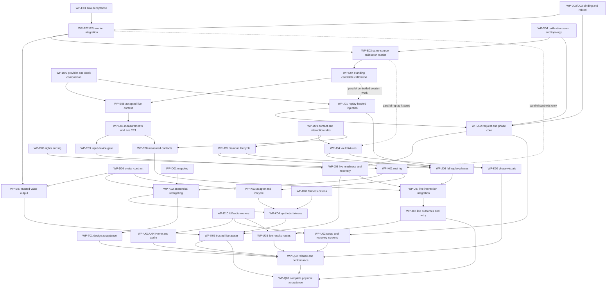

# Laser Heist — Technical Workplan V2

6 November 2026 · Planning owner: Edo · Proposed technical owners: Edo, Kevin, Jevon · Design reviewer: Theo

**Disposition: PROPOSED — documentation planning only.** Architecture V2 remains PROPOSED pending affected-owner sign-off. This catalog is not implementation permission, a board update, a committed schedule or acceptance of B2a. Every `WP-*` identifier is a **new local planning ID, not an existing GitHub issue**. Historical LH identifiers are references only. Proposed ownership follows the task's technical boundaries; unassigned screen/audio implementation remains unassigned until the team decides.

## 1. Executive Summary

Deliver the rear-view avatar game by preserving one human-motion authority and two independent outputs: validated CP1 gameplay evidence for Jevon's sole consumer, and source-correlated numeric avatar input for Kevin. Keep the current App/Games/Shared logical modules, application/test targets and RealityKitContent package. Add game-specific avatar code only under proposed `Sedactive/Games/LaserHeist/Rendering/Avatar/`; do not import the spike's alternative live camera/tracker/calibration/session.

The catalog has **41 proposed packages: 10 decision packages and 31 review/implementation/validation packages** (including the B2a acceptance audit). This is a reviewable backlog, not 41 simultaneous assignments. Completed foundations are excluded from that count. Proposed primary-owner totals: **Edo 13, Kevin 11, Jevon 12, Theo 1 design-review package, UNASSIGNED 4 engineering packages**. Reviewer involvement is not counted as duplicate ownership.

The likely technical gating chain is B2a acceptance → B2b trusted live association → same-source calibration → accepted context/measurements/live CP1 → live session recovery → trusted live avatar and interactions → integrated physical acceptance. It has no calendar estimate: capacity, dates, device access and review availability have not been supplied. Synthetic avatar work, replay-backed composition and contact-domain fixtures should run in parallel after their specific decisions, rather than waiting for the whole input chain.

P1 is a safe **live high/low-laser vertical slice**, not permission to ship an incomplete product. P2 contains mandatory complete-game interactions and UX, including vaults and diamonds. P3 is optional procedural polish. A difficult mandatory interaction is never silently reclassified as polish.

## 2. Current implementation baseline

### 2.1 Verified checkout and evidence limits

| Item | Observed planning baseline |
|---|---|
| Branch / HEAD | `feat/architecture`, `5070c0431b8c3fda6a0a0882e667e2b967edc09c` |
| Available `origin/staging` | Same commit; no fetch/new remote freshness claim |
| Tracking reference | `origin/feat/player-tracking`, `69860cc75d820c76c3ac45cfac09edce651892f7`; B2a READY FOR RE-REVIEW, not merged/live-integrated here |
| Spike reference | `origin/spike/front-facing-avatar`, `6cd062680e5967778125f2b87c01bd189e461229`; renderer concepts only, not an approved live stack |
| Existing local work | Modified lean index; untracked V2, Avatar-01 and `Scripts/CP2Spike/`; preserve all |
| Project conventions | Swift 5 language mode, default MainActor, approachable concurrency; existing targets and package retained |

Actual source and assertions take precedence over old status prose. Prior A2/B1 acceptance reports are historical scoped evidence, not tests newly run by this planning task. No build, benchmark, compiler execution or device test is claimed here.

### 2.2 Completed foundations — preserve, do not recreate

| Existing capability | Current connection / status | Reuse requirement |
|---|---|---|
| CameraPipeline, FrameStore, capture metrics and DEBUG preview | A1/A2 implemented and scoped accepted; retained source owner, bounded copies/reconstruction | One native session and processing consumer; preserve final-owner budgets and source invalidation |
| B1 PoseEstimator / CameraPoseResults | Real synchronous worker-local Vision, immutable source-correlated results, eight retained candidates plus original total count | Preserve anatomical labels, absent joints, source envelope and overflow information |
| CP1 models / BodyInputProviding / ReplayBodyInput | Implemented values and bounded replay provider | Preserve atomic full calibration replacement, revisions/cutovers, one gameplay stream reader and independent status |
| CP2 handoff / pixel copier / renderer | Implemented copied-Data handoff and synthetic rendering path | Retain tests/resources until a separately approved replacement/deprecation; no need to finish continuous cutouts for avatars |
| LaserGame / LaserCollisionJudge / LaserWaveDirector / GameClock | Implemented domain, evidence timing, scoring, scheduling and time primitives | Extend missing interactions/integration; do not redesign working laser rules |
| LaserScene / GameWorldMapping / GameplayScenePresenter | Implemented corridor, hazards, mapping and replay presentation | Reuse scene/lanes; owner review for functional mapping/host edits |
| Replay session, ResultsView and Retry | Working replay path; test-only full-round harness also exists | Preserve replay regressions and distinguish the harness from production live orchestration |

### 2.3 Remaining reality and primary source references

`Shared/BodyTracking/Processing/{PlayerTracker,MotionEngine,CalibrationSession,BodyMeasurementExtractor,JumpDetector}.swift` and `Shared/BodyTracking/BodyInputService.swift` are skeletons on this checkout. `Capture/PersonSegmenter.swift` is also a skeleton. B2a on its separate ref is a pure algorithm awaiting review; it is not physical identity proof. No avatar is present in staging. B1 exposes 14 joint keys and no elbows/knees or measured depth.

`GameSessionCoordinator.start` directly constructs ReplayBodyInput; SessionState does not implement live setup/calibration/countdown/recovery. Home, PlayerSetup and Calibration views are placeholders. AudioService is a skeleton. Vault domain commands exist, but live contacts/complete phase presentation do not. Diamond Time configuration/timing and diamond art exist, but domain spawn/collection/replacement is incomplete; `LaserGame.end` still emits `diamondsCollected: 0`.

Full paths below are repository-relative. For compact package descriptions, these verified prefixes apply; bare filenames inherit the named component's prefix. Brace notation groups existing files; any new filename/directory is explicitly marked **proposed**. Existing test locations are reused; a referenced proposed test file is future work, not evidence of passing tests.

| Catalog shorthand | Exact repository location |
|---|---|
| `App/` | `Sedactive/App/` |
| `Capture/`, `Processing/`, `Models/` | `Sedactive/Shared/BodyTracking/Capture/`, `Sedactive/Shared/BodyTracking/Processing/`, `Sedactive/Shared/BodyTracking/Models/` |
| BodyInputService / ReplayBodyInput | `Sedactive/Shared/BodyTracking/BodyInputService.swift`, `Sedactive/Shared/BodyTracking/ReplayBodyInput.swift` |
| `Domain/`, `Session/`, `Rendering/`, `UI/`, `Debug/` | Corresponding directories under `Sedactive/Games/LaserHeist/` |
| BodyTrackingTests | `SedactiveTests/Shared/BodyTrackingTests/` |
| Domain/Session/Rendering tests | `SedactiveTests/Games/LaserHeist/{DomainTests,SessionTests,RenderingTests}/` |
| GameClock / clock tests | `Sedactive/Shared/GameRuntime/GameClock.swift`, `SedactiveTests/Shared/GameRuntimeTests/GameClockTests.swift` |

Read with [Architecture V2](LaserHeist-Architecture-V2-Avatar-Pivot.md), [Avatar-01](Avatar-01-Rear-View-Representation-Architecture-Proposal.md), [lean layout](Architecture/Game-Oriented-Architecture.md), [TEAM_ALIGNMENT](TEAM_ALIGNMENT.md), [CP1](LH-00-Checkpoint-1-Contract-Proposal.md), [CP2](LH-00-Checkpoint-2-Cutout-Handoff-Proposal.md), [LH-13](LH-13-Live-Camera-Architecture-Proposal.md), [A1](LH-13A1-Camera-Foundation-Report.md), [A2](LH-13A2-Debug-Preview-Implementation-Report.md), [B1](LH-13B1-Raw-Vision-Pose-Implementation-Report.md), [gameplay rules](LaserHeist-Gameplay-Rules.md) and [historical checklist](LaserHeist-Cooperative-Active-Gameplay-DRAFT.md#f-github-ready-checklist). The baseline audit is in the review conversation; do not invent a checked-in audit report.

## 3. Architecture decision register

All decisions are **OPEN**. Decision packages are ready for review, not approved. Closing a decision requires a recorded choice, exact acceptance/verification implications and affected-owner agreement; the author writing a recommendation is insufficient. An implementation package blocked by that decision remains blocked until both approval and its other hard dependencies are satisfied, followed by separate implementation authorization.

| Planning decision | Required outcome | Primary / affected reviewers | Implementation blocked |
|---|---|---|---|
| WP-D01 | Co-facing anatomy, signed arm/step/lean mapping, lane/world basis | Kevin / Edo, Jevon, Theo | K02; dependent avatar/live fairness work |
| WP-D02 | Explicit initial binding and P1/P2-to-lane confirmation UX | Jevon / Edo, Kevin, Theo | E02, J02, U02 |
| WP-D03 | Full rebind/new-generation/recalibration and round recovery policy | Jevon / Edo, Kevin, Theo | E02, J02/J03 and final retry |
| WP-D04 | Calibration request/candidate/cancel/acceptance seam and bounded mask topology | Edo / Jevon, Kevin for scale | E03/E04, live calibration |
| WP-D05 | Provider injection, retained source lifetime and replay/live clock basis | Jevon / Edo, Kevin | J01 and downstream live provider/session wiring |
| WP-D06 | Avatar packet, source/control joins, joint capabilities and freshness/fallback | Kevin / Edo, Jevon for readiness | E07, K02/K03 |
| WP-D07 | Human collision authority and measurable visual fairness | Jevon / Edo, Kevin, Theo | K04 and production avatar acceptance |
| WP-D08 | Character rights/provenance, rig conventions and resource policy | Kevin / Edo, Theo | Asset extraction and K01 |
| WP-D09 | Gameplay wrist/contact evidence, timing/reach and outstanding vault/diamond policy | Edo / Jevon, Kevin, Theo | E08, J04/J05/J07 |
| WP-D10 | Named Swift UI/audio implementation owners and hotspot coordination | Edo / team, Theo for design boundary | U01–U04 |

Working recommendations remain proposals: co-facing anatomy; keep B2a binding semantics with explicit lane confirmation; actual restart/rebind/recalibrate after full identity loss; human-body collision authority with visually aligned avatars. No production numeric thresholds, wrist radius, diamond point value or missed-slot refill policy are selected by this plan.

## 4. Proposed technical ownership

| Owner | Authority retained / proposed work | Does not own |
|---|---|---|
| Edo | Source, camera/Vision, B2 review/integration, calibration and accepted provider, human measurements/contact producer, source/control provenance, App hotspot and integration gates | Renderer IK/rig authority or gameplay verdicts |
| Kevin | Asset technical review, rig/IK/retargeting, numeric renderer adapter, placement/fallback/freshness, RealityKit and visible laser alignment | Identity, accepted calibration, GameClock or human contact judgment |
| Jevon | Single session/GameClock/domain, provider-injection integration, binding/calibration request orchestration, readiness/recovery, vault/diamond rules and results | Another camera/tracker or render-authored evidence |
| Theo | Character/animation/interaction design, instructions and comprehension review | Automatically assigned Swift UI/audio implementation |
| UNASSIGNED | U01–U04 until WP-D10 resolves implementation ownership | Not assumed to be Theo or whichever engineer is free |

App constructs/selects the provider; Jevon's one coordinator retains/consumes it. Edo's retained live bundle executes source controls. Kevin's pure game-specific adapter is App-composed and receives immutable values; Shared never imports RealityKit or Laser Heist rendering. No new global layer, LiveGameSession, CP1 subscriber, camera owner, processing consumer, tracker or accepted-baseline authority.

## 5. Complete work package catalog

Each package provides the requested ID/title, owner, existing status, reason, scope, deliverable, dependencies, acceptance, exclusions, reviewers, parallelism, work kind and disposition. Priority is additional. `Hard dependencies` are completion/approval gates; useful parallel work is identified separately. All packages also require their own scoped authorization before code changes; “ready for review” is not “start implementation.”

Kinds: **architecture-design**, **synthetic-validation**, **integration**, **physical-acceptance**. Dispositions: **ready for review**, **blocked**, **deferred**. Existing accepted capabilities above are **completed foundation**, not new catalog tasks.

For later implementation packages, common verification is mandatory as applicable: focused deterministic tests plus relevant regression, app/test builds and Release boundaries, complete strict concurrency with warnings-as-errors and applicable SIL/WMO/object checks on device and Simulator SDKs under unchanged settings, meaningful ownership negatives, finite resource/cleanup tests, and actual physical validation for camera/render claims. Record definitions versus executions and automated versus manual evidence. Synthetic checks never prove live accuracy, optical latency or collision fairness. No unsafe Sendable/isolation suppression, unbounded Tasks/queues, fake calibration or recording of participant imagery is acceptable.

### WP-D01 — Approve co-facing anatomical and world mapping

- **Primary owner:** Kevin.
- **Priority / type / disposition:** P0 / architecture-design / ready for review.
- **Existing status:** V2 recommends co-facing anatomy; current capture is unmirrored, A2 preview mirrored, and CP2 has lane-local reflection. No avatar mapping is accepted.
- **Why:** Rear-view anatomical motion and raw camera-image direction are different conventions.
- **Scope and paths:** V2 §8 / Avatar-01 §4; read `Rendering/GameWorldMapping.swift` and canonical models. Specify aspect correction, signed physical left/right steps/arms/lean, asset basis versus root mapping, two-player crossing and preview distinction.
- **Deliverable:** Signed transform/example table and test-fixture expectations; no mapping code.
- **Hard dependencies:** None; uses current V2 proposal and source.
- **Acceptance:** Edo/Kevin agree that physical right moves screen-right and right-arm keys drive the right arm, or explicitly select an alternative; Jevon reviews fairness/placement and Theo comprehension. No canonical coordinate/key change or double reflection.
- **Out of scope:** B2 binding changes, producer contract extensions, GameWorldMapping edits.
- **Reviewers:** Edo, Jevon, Theo.
- **Parallel:** Yes, with other decisions and B2a review; control-dependent retargeting waits.

### WP-D02 — Agree explicit binding and setup confirmation

- **Primary owner:** Jevon.
- **Priority / type / disposition:** P0 / architecture-design / ready for review.
- **Existing status:** B2a requires arming and mirrored-display-left P1; no live setup UI or orchestration exists.
- **Why:** An unmirrored setup image puts current P1 on image-right while its avatar occupies the left lane.
- **Scope and paths:** B2a design/ref, V2 §8/§11; define session request/ack, atomic pair binding, slot/lane labels and confirmation before calibration; retain identity through crossing.
- **Deliverable:** Setup/binding command and UX sequence with original control-token requirements.
- **Hard dependencies:** None; this decision uses current contracts and mapping options.
- **Acceptance:** Edo/Jevon agree authorization and exact rejection semantics; Kevin/Theo approve intelligible identity-to-lane confirmation. Explicitly preserve B2a semantics or separately authorize a policy revision; no array-order or automatic activation binding.
- **Out of scope:** Implementing setup screens, tracking policy tuning, facial recognition.
- **Reviewers:** Edo, Kevin, Theo.
- **Parallel:** Yes; review mapping options jointly with WP-D01 before closure, without waiting for a live provider.

### WP-D03 — Agree full-rebind and recovery lifecycle

- **Primary owner:** Jevon.
- **Priority / type / disposition:** P0 / architecture-design / ready for review.
- **Existing status:** B2a's conservative latch requires an externally supplied new source generation; calibration values are generation-bound. Live recovery is absent.
- **Why:** A renderer/tracker reset cannot safely reuse an old person's baseline or restart capture itself.
- **Scope and paths:** `Session/GameSessionCoordinator.swift`, `Shared/GameRuntime/GameClock.swift`, B2a/V2 lifecycle contracts. Define ordinary recovery versus full rebind, actual restart/recalibration, blockers, round continuation/termination and fresh attempts.
- **Deliverable:** Event/state table covering background, interruption, geometry change, lost slot, resume/retry and request cancellation.
- **Hard dependencies:** None; this decision uses existing tracker, calibration and clock contracts.
- **Acceptance:** Edo/Jevon explicitly approve or revise restart-and-recalibrate; document both-player disruption/UX cost, real generation ownership, clock/score preservation and no automatic foreground restart. Kevin/Theo review fallback and instructions.
- **Out of scope:** Fabricated generations, within-generation rebind shortcuts, implementing recovery.
- **Reviewers:** Edo, Kevin, Theo.
- **Parallel:** Yes; review controlled state diagrams and coordinate closure with WP-D02/WP-D04/WP-D05 as one interface discussion, not circular completed-task prerequisites.

### WP-D04 — Agree calibration seam and bounded mask topology

- **Primary owner:** Edo.
- **Priority / type / disposition:** P0 / architecture-design / ready for review.
- **Existing status:** Calibration value types exist; CalibrationSession/PersonSegmenter and live acceptance are unfinished.
- **Why:** LH-22 must validate real candidate results without depending on an unimplemented provider/session.
- **Scope and paths:** V2 §10.1, LH-13 §6; define request/progress/result/cancel tokens, same-source pose/mask pairing, candidate conversion/revision ownership and same-worker versus separately bounded immutable-source mask work.
- **Deliverable:** Minimal internal seam, explicit source/workspace budgets and primary-path admission rules.
- **Hard dependencies:** None; current source and existing CP1 replacement contract suffice for design.
- **Acceptance:** Edo/Jevon agree candidate-versus-acceptance separation, stale/canceled rejection and controlled LH-22 driver; no second baseline store or dependency cycle. Kevin reviews shared scale/visual implications. Any new source budget is explicitly reviewed, not silently enlarged.
- **Out of scope:** Segmentation implementation, public CP1 changes, continuous cutouts.
- **Reviewers:** Jevon, Kevin.
- **Parallel:** Yes, with tracker review and rig design.

### WP-D05 — Agree provider injection and clock/control composition

- **Primary owner:** Jevon.
- **Priority / type / disposition:** P0 / architecture-design / ready for review.
- **Existing status:** Coordinator constructs ReplayBodyInput; DEBUG AppDependencies retains the camera; replay advancement assumes synthetic source time.
- **Why:** Swapping a concrete type alone would preserve invalid replay scheduling assumptions in live mode.
- **Scope and paths:** `App/{AppDependencies,RootView}.swift`, `Session/{GameSessionCoordinator,LaserReplayScript}.swift`, `UI/LaserReplayPresentation.swift`, `Shared/GameRuntime/GameClock.swift`. Specify one injected provider, replay-only driver, live host-clock source, retained source controls and observer ownership.
- **Deliverable:** Constructor/lifetime/control design and replay/live time-mapping test cases.
- **Hard dependencies:** None; this decision uses the actual replay coordinator/provider and current source contracts.
- **Acceptance:** App selects/constructs; one coordinator retains and claims the CP1 stream/status; one source executes start/stop; diagnostics cannot compete for control. No LiveGameSession, second game clock or renderer-owned start/calibration.
- **Out of scope:** Implementing DI, changing CP1, adding frameworks or targets.
- **Reviewers:** Edo, Kevin.
- **Parallel:** Yes; agree lifecycle choices jointly with WP-D03. Replay-backed implementation can follow before live input exists.

### WP-D06 — Agree avatar packet, capabilities and invalidation

- **Primary owner:** Kevin.
- **Priority / type / disposition:** P0 / architecture-design / ready for review.
- **Existing status:** Proposed AvatarPoseFrame/adapter; B1 currently has 14 joints and no elbows/knees/depth.
- **Why:** A rich rig must not manufacture observed anatomy, identity or calibrated evidence.
- **Scope and paths:** V2 §5/§7, Avatar-01 §5–6; proposed `Rendering/Avatar/PresentationPose.swift` and `AvatarPoseAdapter.swift`. Define original source/control, two slot outcomes, observed/derived/procedural distinctions, optional calibration capability, bounded latest-only transport and independent status.
- **Deliverable:** Immutable numeric packet/adapter contract and versioned freshness/fallback policy requirements.
- **Hard dependencies:** None; packet design uses existing B1/CP1 values and the mapping alternatives.
- **Acceptance:** Edo/Kevin agree exact-source joins, missing joints, one pending/current pair, no-frame expiry and immediate invalidation without another CP1 observer/reader. Jevon approves readiness implications. Elbow/knee extensions remain separate if needed.
- **Out of scope:** Public CP1/B1 extension, raw image resources, pose filtering implementation.
- **Reviewers:** Edo, Jevon; Theo for unavailable-state presentation.
- **Parallel:** Yes, while input algorithms are unfinished; co-review signed mapping with WP-D01 before implementation.

### WP-D07 — Agree human-geometry visual fairness criteria

- **Primary owner:** Jevon.
- **Priority / type / disposition:** P0 / architecture-design / ready for review.
- **Existing status:** Human crown/wrist and sole/airborne rules implemented; avatar scaling/latency policy proposed only.
- **Why:** A visually clear robot can disagree with the authoritative human verdict.
- **Scope and paths:** V2 §9.1, `Domain/LaserCollisionJudge.swift`, `Rendering/GameWorldMapping.swift`; compare height-preserving versus normalized visuals, root lift, wrist/foot clearance, source-to-crossing timing and smoothing residuals.
- **Deliverable:** Approved first policy and measurable synthetic/physical comparison protocol with criteria to be selected from evidence.
- **Hard dependencies:** None; criteria design uses current human rules and the proposed representation alternatives.
- **Acceptance:** Edo/Kevin/Jevon explicitly agree human authority or separately propose a rule change; declare measurement method/decision process without invented production thresholds. No mesh/IK contact becomes HIT/CLEAR.
- **Out of scope:** Changing checker margins/windows or claiming physical fairness.
- **Reviewers:** Edo, Kevin, Theo.
- **Parallel:** Yes; criteria design precedes live input, with mapping/packet implications reviewed jointly with WP-D01/WP-D06.

### WP-D08 — Clear character provenance, rig and resource policy

- **Primary owner:** Kevin.
- **Priority / type / disposition:** P0 / architecture-design / ready for review.
- **Existing status:** Spike USDZ and rig code exist only on its pinned ref; attribution/hash is not a complete rights record.
- **Why:** Asset copying/distribution and rig assumptions need explicit clearance before adoption.
- **Scope and paths:** Pinned spike `Rendering/Avatar/Robot/laserheist-robot.usdz`, RobotSkeleton/RobotAvatar and `Docs/Avatar-Spike/robot/README.md`; inspect provenance, modification/distribution/attribution, axes/joint names and Debug/Release resource strategy.
- **Deliverable:** Recorded rights/provenance and technical rig contract, or a documented approved replacement route.
- **Hard dependencies:** None; read-only inspection can proceed independently.
- **Acceptance:** Kevin/Theo/Edo sign off source/rights and intended character; record required import checks and resource policy. An absent license or unknown origin blocks asset extraction; no legal clearance is inferred from a filename.
- **Out of scope:** Copying assets, adopting excluded live adapters, generating replacement art here.
- **Reviewers:** Edo, Theo.
- **Parallel:** Yes; rights unresolved blocks copying, not pure packet design.

### WP-D09 — Agree live contact evidence and interaction rules

- **Primary owner:** Edo.
- **Priority / type / disposition:** P0 / architecture-design / ready for review.
- **Existing status:** CP1 has wrist Y, not full hand positions; raw Vision wrists and scripted vault contacts are not calibrated live contacts. Gameplay G1/G11/G12/G14 retain open details.
- **Why:** Vaults and diamonds are required interactions; avatar hands cannot supply their authority.
- **Scope and paths:** `Models/BodyGeometry.swift`, `Domain/{LaserGame,LaserRoundConfiguration}.swift`, gameplay rules B4/B4a/G. Specify validated position/reach/validity/source fields, timing/arrival/boundary/deduplication, eligible wrists/players, trajectory/areas, score selection, initial population and missed-slot policy.
- **Deliverable:** Edo-owned evidence proposal plus Jevon-owned interaction/score decision table, reviewed visual-zone contract; choose a single-session-reader route.
- **Hard dependencies:** None; review with existing calibration/clock contracts.
- **Acceptance:** Edo/Jevon agree feasibility and exact producer/consumer boundary; Kevin/Theo agree reach and cues. Distinguish task-owner confirmed rules from still-open value/radius/dwell/phase-order decisions. No automatic CP1 extension, laser-window reuse or new second subscriber.
- **Out of scope:** Contact algorithms, renderer collision verdicts, new gestures or automatic missed-slot refill.
- **Reviewers:** Jevon, Kevin, Theo.
- **Parallel:** Yes; enables domain fixtures before live wrist implementation.

### WP-D10 — Resolve UI/audio engineering ownership

- **Primary owner:** Edo, as Tech Lead facilitating team agreement.
- **Priority / type / disposition:** P0 / architecture-design / ready for review.
- **Existing status:** Team alignment leaves screen/audio implementation unassigned; results/retry already have replay code.
- **Why:** A three-engineer plan cannot count unassigned production work as implicitly staffed.
- **Scope and paths:** Current `UI/{HomeView,PlayerSetupView,PlayerSetupState,CalibrationView,ResultsView}.swift`, `Shared/Audio/AudioService.swift`, App hotspot. Review U01–U04 capacity, code ownership and Theo design handoffs.
- **Deliverable:** Named implementation owners and reviewer/hotspot agreement for U01–U04, or explicit delivery risk retained.
- **Hard dependencies:** None; do not wait for camera work to discuss capacity.
- **Acceptance:** Team confirms each engineering owner and scope; Theo remains design reviewer unless a separate explicit implementation assignment is agreed. This package does not silently update TEAM_ALIGNMENT/boards.
- **Out of scope:** Assigning tasks by this document alone, UI/audio code, deadlines or assumed spare capacity.
- **Reviewers:** Jevon, Kevin, Theo; Tech Lead approves final allocation.
- **Parallel:** Yes; resolve early enough to avoid a final delivery bottleneck.

### WP-E01 — Independently close B2a identity-safety acceptance

- **Primary owner:** Edo.
- **Priority / type / disposition:** P0 / architecture-design / ready for review.
- **Existing status:** Pure tracker on `origin/feat/player-tracking` is READY FOR RE-REVIEW after competitor and same-frame corrections; staging file is a skeleton.
- **Why:** Live integration must not treat corrected-but-unaccepted code as an approved identity authority.
- **Scope and paths:** Read pinned PlayerTracker, PlayerTrackerTests and B2a report §§12–15; review evaluate/resolve/commit, supported/excluded/unavailable competition, symmetric counterexamples, bounds, provenance and monotonic rebind.
- **Deliverable:** Independent ACCEPTED-pure-core or REVISE decision with counterexample/evidence and explicit numerical-policy limits.
- **Hard dependencies:** None; existing design and corrected evidence are available.
- **Acceptance:** Verify source and corresponding tests/results; rerun required focused evidence when later authorized/available. No slot-order bypass/history advancement; preserve original failing history. Acceptance is pure-core only, not physical identity or live thresholds.
- **Out of scope:** B2b, automatic merge, policy relaxation to conceal ambiguity, live accuracy claims.
- **Reviewers:** Jevon for lifecycle implications; independent technical review coordinated by Edo.
- **Parallel:** Yes, with all decision packages and synthetic design.

### WP-E02 — Integrate one worker-owned live tracker

- **Primary owner:** Edo.
- **Priority / type / disposition:** P1 / integration / blocked.
- **Existing status:** Accepted B1 is connected; MotionEngine/PlayerTracker are skeletons here and B2b is absent.
- **Why:** Raw frame-local candidates are not trusted persistent P1/P2.
- **Scope and paths:** `Processing/{PlayerTracker,MotionEngine}.swift`, existing Capture worker/result seams and numeric diagnostics; incorporate accepted B2a through separately reviewed Git integration, not spike tracking. Stamp original control at admission, stage state and source-gate commit/publication; handle no-frame expiry.
- **Deliverable:** One-worker B2b with versioned experimental live policy and bounded numeric tracking diagnostics.
- **Hard dependencies:** WP-E01, WP-D02, WP-D03.
- **Acceptance:** Deterministic order/crossing/overflow/loss/rebind and delayed-stop/context cases; frozen confirmed history on refusals; one tracker/consumer, finite history and no raw CV/VN transfers. Physical numeric protocol demonstrates observations/uncertainty and records policy limits; no silent replacements or universal identity claim.
- **Out of scope:** Calibration, CP1 live evidence, skeleton overlay, gameplay readiness.
- **Reviewers:** Jevon for controls/recovery; Kevin for source/presentation compatibility.
- **Parallel:** After gates, alongside K/J synthetic and replay-backed work; serialize shared Capture changes.

### WP-E03 — Build calibration-only same-source mask sampling

- **Primary owner:** Edo.
- **Priority / type / disposition:** P1 / integration / blocked.
- **Existing status:** PersonSegmenter is a skeleton; B1 publishes unavailable mask association.
- **Why:** Reliable crown/independent sole references need actual associated calibration evidence, not a whole-mask shortcut.
- **Scope and paths:** `Capture/PersonSegmenter.swift`, reviewed FrameStore/worker seam, proposed `PersonSegmenterTests.swift` in existing BodyTrackingTests. Implement only approved calibration topology, exact pose/mask/source join, bounded admission/workspace/source lifetime and association refusal.
- **Deliverable:** Calibration sample producer with numeric quality/provenance and explicit skip/rejection reasons.
- **Hard dependencies:** WP-E02, WP-D04.
- **Acceptance:** Same generation/epoch/frame/time/geometry/orientation per pair; no instance-index PlayerID, cross-frame latest join or unbounded mask queue. Test source release/cancel/budget/backpressure and overlap/independent feet; measure primary-path effect on target iPad before approving topology.
- **Out of scope:** Continuous cutouts, CP2 upload, a second camera/processing consumer, final accepted calibration.
- **Reviewers:** Jevon for request cancellation; Kevin for source/scale implications.
- **Parallel:** With synthetic avatar/session work; within Edo's source files it precedes E04 and needs coordinated edits.

### WP-E04 — Produce validated standing calibration candidates

- **Primary owner:** Edo.
- **Priority / type / disposition:** P1 / integration / blocked.
- **Existing status:** PlayerCalibration values exist; CalibrationSession algorithm/request handling does not.
- **Why:** Replay constants and rig dimensions cannot substitute for two real standing baselines.
- **Scope and paths:** `Processing/CalibrationSession.swift`, MotionEngine request seam; proposed `CalibrationSessionTests.swift`. Implement bounded numeric aggregation, independent head/foot offsets, floor/scale/mapping inputs, stability/confidence rejection and request-scoped cancellation/progress.
- **Deliverable:** Real validated P1/P2 candidate results through a controlled driver, not an accepted provider dictionary.
- **Hard dependencies:** WP-E03, WP-D04.
- **Acceptance:** Deterministic valid/rejected/partial/canceled/stale cases; same-source contributing pairs and original final contributing provenance; correct anatomical feet, no false valid crown from raised arms. Physical different-height standing observations recorded. Prove correctness without C or D implementation.
- **Out of scope:** Provider acceptance/revision store, full session UI, live jump evidence or cosmetic robot scale.
- **Reviewers:** Jevon for request/result semantics; Kevin for compatible visible scale.
- **Parallel:** With K/J work; cannot depend on a future live session to test the algorithm.

### WP-E05 — Implement authoritative live accepted context

- **Primary owner:** Edo.
- **Priority / type / disposition:** P1 / integration / blocked.
- **Existing status:** Replay implements CP1; BodyInputService is a skeleton.
- **Why:** There must be one accepted calibration context for live processing and all consumers.
- **Scope and paths:** `BodyInputService.swift`, existing provider/model APIs and live bundle composition coordinated with App; add controlled live-provider tests in BodyTrackingTests. Implement start/stop/status, candidate conversion gate, full replacement, per-player revisions/cutovers and ordered read-only worker-context commands.
- **Deliverable:** Live provider lifecycle/context shell using real E04 results; no fake valid body measurements.
- **Hard dependencies:** WP-E04, WP-D04, WP-D05.
- **Acceptance:** Empty → P1 → both → P2/removal/reacceptance tests; invalid replacement is atomic; unchanged baselines retain revisions; stale in-flight work cannot commit. One status/stream claim, cancellation and no-frame interruption; controlled callers suffice before D. Context activity is not gameplay readiness.
- **Out of scope:** Inventing a new CP1 API/schema, separate accepted store, completing all body measurements or game phases.
- **Reviewers:** Jevon; Kevin for context/status fork compatibility; Edo maintains App edits.
- **Parallel:** J01/J02 and synthetic rendering can proceed independently; this gate follows real calibration.

### WP-E06 — Publish measured human evidence through live CP1

- **Primary owner:** Edo.
- **Priority / type / disposition:** P1 / integration / blocked.
- **Existing status:** BodyMeasurementExtractor/JumpDetector are skeletons; no live BodySnapshot producer exists.
- **Why:** LaserGame needs valid human crown/wrists/soles and causal airborne evidence, not visible animation.
- **Scope and paths:** `Processing/{BodyMeasurementExtractor,JumpDetector,MotionEngine}.swift`, BodyInputService and their existing test locations. Compute per-measurement validity from accepted baselines and trusted source; implement bounded causal jump state and CP1 delivery/cache/status.
- **Deliverable:** LH-13C live combined BodySnapshots with original frame/time/context and exactly two slot samples.
- **Hard dependencies:** WP-E05.
- **Acceptance:** Independent crown/wrist/sole failures, nonairborne foot lift, stale/context/cutover/cancel cases; no prior-frame/other-player substitution. Preserve configured CP1 bounds/completion semantics, one reader and source-gated state commits; publish without waiting for rendering. Physical algorithm checks are recorded as such, not synthetic proof.
- **Out of scope:** Gameplay collision decisions, actual repetition metrics, avatar IK, contact extensions.
- **Reviewers:** Jevon for evidence/rule compatibility; Kevin for same-source numeric fork.
- **Parallel:** With K/J fixture work; split review checkpoints into measurement/jump correctness then provider publication, within one evidence package.

### WP-E07 — Expose bounded source/association output for avatars

- **Primary owner:** Edo.
- **Priority / type / disposition:** P1 / integration / blocked.
- **Existing status:** B1 cache exists; no trusted numeric presentation output or internal status tee is connected.
- **Why:** Kevin must receive trusted same-source values without another tracker, camera observer claim or CP1 reader.
- **Scope and paths:** MotionEngine/internal result-envelope seam and existing source-control boundary; proposed reusable numeric output types beside Processing if required. Expose original source/control, trusted slot-to-candidate mapping, observed joints and ordered invalidation; no game imports in Shared.
- **Deliverable:** Bounded reusable value producer exercised by a slow mock sink, ready for Kevin's pure adapter.
- **Hard dependencies:** WP-E02, WP-D06.
- **Acceptance:** One pending/current pair or reviewed stricter numeric bound; reject stale source/control; clear without frames; preserve original absence/confidence and candidate cap. Delayed/stuck visual consumer cannot block primary work or CP1. Test optional reference-context updates with controlled values; actual accepted-reference/measurement connection is completed with E05/E06 in K05.
- **Out of scope:** Defining a second accepted context, RealityKit imports, game-specific retargeting or extending CP1.
- **Reviewers:** Kevin for producer/adapter match; Jevon for CP1 independence.
- **Parallel:** Can follow B2b before LH-22/C because uncalibrated direction-only output is explicit; no claim of calibrated root/jump.

### WP-E08 — Produce validated hand/wrist interaction evidence

- **Primary owner:** Edo.
- **Priority / type / disposition:** P2 / integration / blocked.
- **Existing status:** Raw wrists exist and CP1 has wrist Y only; no complete gameplay contact/reach producer.
- **Why:** Vault/diamond interaction needs calibrated position/validity and timing under the trusted player context.
- **Scope and paths:** Reviewed evidence surface in `Shared/BodyTracking/Models/` (**new type/file only if D09 approves**), measurement/provider seam and deterministic tests. Implement human wrist/hand/reach inputs, not contact verdicts; preserve single session-consumer route.
- **Deliverable:** Approved immutable interaction evidence, synthetic/physical measurement characterization and source/status invalidation.
- **Hard dependencies:** WP-E06, WP-D09.
- **Acceptance:** Left/right/partial/weak/stale/out-of-frame/revision cases, original source and independent validity; no avatar/IK/contact substitution. Verify reach for different heights and no new unsafe gestures. Any CP1 extension follows explicit contract/replay compatibility review.
- **Out of scope:** Deciding pickups/button activation, changing laser rules, a second gameplay subscriber.
- **Reviewers:** Jevon; Kevin/Theo for interaction area/reach compatibility.
- **Parallel:** Domain fixture and visual-zone work can precede this; actual live contact waits.

### WP-E09 — Accept the integrated live input foundation on device

- **Primary owner:** Edo.
- **Priority / type / disposition:** P1 / physical-acceptance / blocked.
- **Existing status:** A2/B1 physical gates passed only within their scopes; trusted/calibrated CP1 has no physical acceptance.
- **Why:** Synthetic tracking/calibration/provider tests do not establish real two-person evidence quality.
- **Scope and paths:** Existing numeric diagnostics/metrics and tests; proposed milestone validation report. Finite M4 runs for two heights, crossing/overlap/extra entrants, partial/loss/reentry, jumps/ducks, no-frame status, stop/background/geometry and cleanup.
- **Deliverable:** Device evidence and versioned policy decisions sufficient for live session integration, or explicit REVISE findings.
- **Hard dependencies:** WP-E06.
- **Acceptance:** Distinguish camera/processing FPS, uncertainty, per-measurement validity, p50/p95 age/processing, drops, accounted bytes/RSS/thermal and manual observations. Confirm no silent swap or valid stale evidence; choose evidence-based tuning with reviewer agreement. No required 30 FPS Vision guarantee or participant recordings.
- **Out of scope:** Whole-game/avatar acceptance, production threshold claims without review, reopening accepted camera infrastructure absent a reproduced defect.
- **Reviewers:** Jevon and Kevin for downstream input/latency suitability; Theo for safe instructions.
- **Parallel:** With J/K synthetic integration; device slots must be coordinated. E02/E03/E04 also perform their scoped physical checks earlier.

### WP-K01 — Import and validate the synthetic rear-view rig

- **Primary owner:** Kevin.
- **Priority / type / disposition:** P1 / synthetic-validation / blocked.
- **Existing status:** Corridor exists; robot asset/rig only on the spike and not cleared for copying.
- **Why:** Establish a minimum coherent representation without taking the spike's live stack.
- **Scope and paths:** Proposed `Rendering/Avatar/Robot/{RobotSkeleton,RobotAvatar}.swift` and cleared USDZ, proposed rendering tests. Selectively adapt load/clone/rig validation and minimal rest-pose IK from Avatar-01's extraction list; attach a synthetic DEBUG host only through reviewed App/scene edits.
- **Deliverable:** Two independently owned rear-view robots in the existing corridor, validated skeleton/import and bounded layer teardown.
- **Hard dependencies:** WP-D08.
- **Acceptance:** Correct back-to-viewer/forward-into-corridor axes, unique required joints, finite bind transforms, two independent clones, positive scale and no duplicate lights/hooks after reopen. Verify target/resource lookup without local absolute asset paths; actual rendered inspection distinct from numeric tests.
- **Out of scope:** Live source/session, full retargeting, CP2 deletion, copying spike host/live files wholesale.
- **Reviewers:** Edo for extraction/composition; Theo for character; Jevon if the host touches session signals.
- **Parallel:** Yes, with input work after asset gate; does not need live calibration or final control mapping to inspect a rest rig.

### WP-K02 — Retarget anatomy and place avatars with basic IK

- **Primary owner:** Kevin.
- **Priority / type / disposition:** P1 / synthetic-validation / blocked.
- **Existing status:** Spike contains richer retargeting/IK; staging has no avatar. B1 lacks elbow/knee observations.
- **Why:** Prove intuitive motion and feasible poses before connecting real people.
- **Scope and paths:** Proposed `Rendering/Avatar/{PresentationPose,PoseSmoothing}.swift`, RobotAvatar/RobotSkeleton and synthetic fixtures/tests. Implement named arm/torso/limited-leg mapping, lane/world placement, candidate scale/root lift and missing-joint rules with explicit procedural elbows/knees.
- **Deliverable:** Deterministic rest/arms/lean/crouch/jump/asymmetric/short-tall comparison scenes and bounded retargeter.
- **Hard dependencies:** WP-K01, WP-D01, WP-D06.
- **Acceptance:** Physical-side fixture labels map correctly, source coordinates unchanged, no negative scale/double rotation, missing joints not zeroed, finite IK/reach limits and no size pumping. Distinguish observed joints, derived directions and cosmetic bend/contact. Demonstrate jump lift without double counting feet/root and no invented airborne evidence.
- **Out of scope:** Procedural stepping, physical accuracy, final fairness threshold approval, B1/CP1 extension.
- **Reviewers:** Edo for anatomy/capabilities; Jevon for clearance implications; Theo for motion comprehension.
- **Parallel:** With E/J packages; K03 may proceed on separate files, with RobotAvatar edits serialized.

### WP-K03 — Implement numeric avatar adapter and presentation lifecycle

- **Primary owner:** Kevin.
- **Priority / type / disposition:** P1 / synthetic-validation / blocked.
- **Existing status:** Packet/adapter proposed; CP2 consumer is not a numeric avatar authority.
- **Why:** Source-correlated visual delivery must be safe before it receives live values.
- **Scope and paths:** Proposed `Rendering/Avatar/AvatarPoseAdapter.swift`, PresentationPose and renderer layer, rendering tests. Implement pure game-specific projection composed by App, bounded pending/current packets, context/attachment tokens, freshness, partial-slot fallback and release; use controlled producers/clocks.
- **Deliverable:** Immutable packet/adapter plus two-rig consumer that rejects stale/incompatible work without another CP1 claim.
- **Hard dependencies:** WP-D06, WP-K01.
- **Acceptance:** Exact original source/control/dimensions/orientation and compatible reference checks; latest-only replacement, one slow consumer, cancel/delayed load and no-frame expiry tests. No stale frame revival, hidden confidence repair or extra source owner. Attachment/context changes clear active motion; MainActor grouped updates are not claimed frame-atomic rendering.
- **Out of scope:** Shared identity/calibration algorithms, raw buffers, live source tee implementation, gameplay state.
- **Reviewers:** Edo for adapter/source seam; Jevon for status/readiness consequences; Theo for fallback clarity.
- **Parallel:** With K02 and E07 after contract review, using immutable fixtures. App integration changes stay Edo-coordinated.

### WP-K04 — Validate synthetic human-versus-avatar clearance

- **Primary owner:** Kevin.
- **Priority / type / disposition:** P1 / synthetic-validation / blocked.
- **Existing status:** Human checker/mapping exist; avatar spatial/temporal agreement is unverified.
- **Why:** A decorative duck/jump must not visually contradict crown/wrist/sole judgments.
- **Scope and paths:** V2 §9.1, existing GameWorldMapping/LaserScene, proposed avatar fixtures/rendering tests. Compare approved human geometry against rig head/hands/feet at laser interaction depth, height policies and smoothing delay.
- **Deliverable:** Measured synthetic residual/clearance report with actual render evidence and approved next live test matrix.
- **Hard dependencies:** WP-K02, WP-K03, WP-D07.
- **Acceptance:** Cases around existing beam/margin boundaries, unequal wrists/soles, nonairborne lift, short/tall pairs, stale slots and reach limits. Record selected human evidence versus displayed source/time separately; no hidden beam/judge changes. Resolve misleading clearance or block production integration.
- **Out of scope:** Physical tracking validation, changing margins/windows, optical latency claim, mesh-derived verdicts.
- **Reviewers:** Edo and Jevon; Theo for perceived clearance/cues.
- **Parallel:** With E/J live preparation; does not wait for physical calibration to use explicit synthetic references.

### WP-K05 — Integrate trusted calibrated live avatars

- **Primary owner:** Kevin.
- **Priority / type / disposition:** P1 / integration / blocked.
- **Existing status:** No live avatar exists; accepted input foundation and synthetic renderer must be joined through approved seams.
- **Why:** The production visual must use the same trusted source/association as gameplay without delaying CP1.
- **Scope and paths:** Proposed Avatar layer/adapter, existing LaserScene/PlayView and Edo-owned App composition through reviewed patches. Join E07 output and actual E05/E06 accepted context/evidence, select one player representation host mode and connect ordered lifecycle invalidation.
- **Deliverable:** Live two-avatar presentation under the single session/source, with bounded diagnostics and physical spatial/temporal observations.
- **Hard dependencies:** WP-E06, WP-E07, WP-E09, WP-K04, WP-J03.
- **Acceptance:** Both heights/arms/steps, uncertainty/loss/rebind, geometry/background/restart and renderer reopen; exact-source packet/debug data, immediate incompatible fallback, no extra subscriber/tracker. Measure visual age/retarget cost and primary capture/CP1 backpressure before/after; full-game fairness still requires Q01.
- **Out of scope:** Stable tracking implementation, changing calibration/collision, skeleton-to-preview overlay or continuous cutouts.
- **Reviewers:** Edo and Jevon; Theo for control comprehension.
- **Parallel:** Fixture adapter work precedes dependencies in K03; final live activation waits. A separately scoped direction-only experiment is not completion of this calibrated package.

### WP-K06 — Complete vault/diamond/phase visual feedback

- **Primary owner:** Kevin.
- **Priority / type / disposition:** P2 / integration / blocked.
- **Existing status:** VaultDoor/Diamond art and feedback exist; production presenter does not fully drive the required phase interactions.
- **Why:** Required full-game mechanics need visible zones, button states, approaches, pickups/misses and phase progress.
- **Scope and paths:** Existing `Rendering/{GameplayScenePresenter,LaserScene,VaultDoor,Diamond,LaserFeedback}.swift` and HUD integration. Consume Jevon's approved read-only IDs/state/events, trajectories and interaction areas; reuse art and pooling.
- **Deliverable:** Replay/synthetic-driven complete phase presentation, ready for the same live domain events.
- **Hard dependencies:** WP-J04, WP-J05.
- **Acceptance:** Three buttons/side and shared deadline, correct moving diamond passage, single terminal animation/award cue, no stale collected IDs, distinct max-four replacement feedback, pause/phase exit cleanup and bounded entities. No renderer-timer expiry/contact judgment; verify glow/depth and cues in actual scene.
- **Out of scope:** Domain spawn/contact/score authority, redesigning laser verdicts, assigning audio implementation.
- **Reviewers:** Jevon for event/trajectory timing; Edo for input-space alignment; Theo for clarity.
- **Parallel:** With live input work using domain fixtures; coordinate presenter/scene edits with K05 rather than competing branches touching the same entities.

### WP-K07 — Optional procedural foot planting and motion polish

- **Primary owner:** Kevin.
- **Priority / type / disposition:** P3 / synthetic-validation / deferred.
- **Existing status:** Spike foot planner exists; baseline has no avatar and basic IK is sufficient for first validation.
- **Why:** Improve visual stance only if basic animation is already fair and resource cost justifies it.
- **Scope and paths:** Proposed `Rendering/Avatar/Robot/RobotFootPlanner.swift`, bounded per-foot state/filter policy and adapted synthetic tests from the spike.
- **Deliverable:** Optional versioned cosmetic stance/step candidate with reset/reach/performance characterization.
- **Hard dependencies:** WP-K05, WP-K04; separate prioritization/authorization after minimum presentation is accepted.
- **Acceptance:** No manufactured physical contact/airborne evidence, no planted jumping feet, finite deterministic clamps, release/reset on invalidation and no gameplay/performance regression. If unnecessary or misleading, leave disabled/deferred.
- **Out of scope:** New gameplay gestures, human measurement reconstruction, mandatory product gate.
- **Reviewers:** Edo, Jevon, Theo.
- **Parallel:** Only after core integration is stable; not on the minimum/complete-game critical path.

### WP-J01 — Inject the provider and separate replay driving

- **Primary owner:** Jevon.
- **Priority / type / disposition:** P1 / integration / blocked.
- **Existing status:** Coordinator directly constructs ReplayBodyInput; LaserReplayPresentation advances synthetic elapsed time.
- **Why:** Live mode needs a different source clock/control path without replacing the game/domain/session.
- **Scope and paths:** `Session/{GameSessionCoordinator,LaserReplayScript}.swift`, `UI/LaserReplayPresentation.swift`, GameClock tests and App/PlayView owner-reviewed wiring. Inject existing BodyInputProviding; isolate fixture advance/vault/coverage scheduling and explicit replay/live time-source adapters.
- **Deliverable:** Same coordinator works with replay and a controlled provider; replay behavior preserved before live provider availability.
- **Hard dependencies:** WP-D05.
- **Acceptance:** One stream/status claim, release/cancel/reentry tests, synthetic offset/rate/paused capture conversion cases and no frames accepted under newer context after suspension. Domain/checker rules unchanged; replay-only `advance(to:)` does not enter CP1 or live mode; no second clock/session.
- **Out of scope:** Real camera/calibration, implementing all live phases, changing signing/settings.
- **Reviewers:** Edo for App/provider lifetime; Kevin for host/update hook ownership.
- **Parallel:** Yes, early with replay/controlled dependencies while Edo develops live algorithms.

### WP-J02 — Implement request orchestration and session phase core

- **Primary owner:** Jevon.
- **Priority / type / disposition:** P1 / integration / blocked.
- **Existing status:** SessionState has idle/running/finished/failed; no live binding/calibration phase logic.
- **Why:** Screens and input algorithms need a single authority for authorized requests and transitions.
- **Scope and paths:** `Session/{GameSessionCoordinator,SessionState}.swift`, proposed narrowly scoped request values if needed, existing SessionTests. Implement setup/bind-confirm/calibrate/cancel/ready progression against controlled source/provider ports and original tokens.
- **Deliverable:** Deterministic state/request core and read-only screen actions/status, ready for real E04/E05.
- **Hard dependencies:** WP-J01, WP-D02, WP-D03, WP-D04.
- **Acceptance:** Explicit arming, atomic pair confirmation, no readiness from visible avatars, cancel/late results, empty/partial calibration and committed full-replacement semantics; every transition tested without a live provider. No duplicate accepted store or source generation fabrication.
- **Out of scope:** Real algorithm work, assigning UI implementers, declaring LH-13D live acceptance.
- **Reviewers:** Edo; Kevin/Theo for fallback and instruction state handoff.
- **Parallel:** Yes, with controlled ports before C; real candidate/source integration is completed in J03 after C.

### WP-J03 — Integrate live readiness, GameClock and recovery

- **Primary owner:** Jevon.
- **Priority / type / disposition:** P1 / integration / blocked.
- **Existing status:** Domain/clock primitives exist; replay session is not live lifecycle integration.
- **Why:** Technical uncertainty must pause cooperative play safely and resume only under trusted readiness.
- **Scope and paths:** Coordinator/SessionState/GameClock and reviewed App/provider wiring; retain one gameplay iterator through ordinary pause. Connect actual request/result/accepted-context/status, host-time anchors, countdown and independent blockers.
- **Deliverable:** LH-13D live session integration and numeric acceptance evidence for a high/low-laser slice.
- **Hard dependencies:** WP-J02, WP-E09.
- **Acceptance:** Two compatible accepted calibrations plus reliable settled identity before countdown; no-frame interruption, stop/background/geometry, manual pause and rebind cases; no damage from missing evidence, no awards during pause, fresh attempts and post-suspension context gates. Real source restart follows D03 and no automatic foreground restart. Physical cases supplement deterministic tests.
- **Out of scope:** Avatar-derived readiness, unapproved recovery timing thresholds, completing all wrist interactions.
- **Reviewers:** Edo; Kevin for render-hook/fallback integration; Theo for recovery UX.
- **Parallel:** Controlled cases start in J02; actual live gate waits for E09. K fixture work remains independent.

### WP-J04 — Complete vault phase mechanics against contact fixtures

- **Primary owner:** Jevon.
- **Priority / type / disposition:** P2 / integration / blocked.
- **Existing status:** LaserGame has openVault/touchVault/timeout/progress; replay scripts synthesize valid touches, but full phase/contact integration is unfinished.
- **Why:** Preserve working vault logic while making all remaining timing/recovery/contact semantics executable.
- **Scope and paths:** `Domain/{LaserGame,LaserGameState,LaserEncounter}.swift`, Session phase adapters and Domain/SessionTests. Use D09-approved immutable contact fixtures; cover three buttons/side in any order/either hand, deadlines, deduplication and interrupted vault continuation.
- **Deliverable:** Complete authoritative vault state/events and fixture-driven phase tests, with renderer handoff.
- **Hard dependencies:** WP-D09.
- **Acceptance:** Both sides complete within approved deadline policy; repeated/invalid/late contact gives no progress; timeout ends round; pause preserves committed buttons/remaining time per rules and rejects in-flight old contacts. No duplicate awards or automatic touchscreen substitution.
- **Out of scope:** Rewriting already correct commands, live wrist estimation, making Kevin's entities collision authority.
- **Reviewers:** Edo for evidence; Kevin/Theo for reachable zones and feedback.
- **Parallel:** Yes, fixtures permit useful progress before E08/J03; no live-provider dependency.

### WP-J05 — Implement authoritative diamond lifecycle and scoring

- **Primary owner:** Jevon.
- **Priority / type / disposition:** P2 / integration / blocked.
- **Existing status:** Configuration/phase timer and art exist; spawn/collect/miss/replacement/summary counts do not.
- **Why:** Complete required diamond mechanics rather than treating them as avatar polish.
- **Scope and paths:** `Domain/{LaserGame,LaserGameState,LaserRoundConfiguration,RoundSummary}.swift`, proposed focused diamond value type only if needed, deterministic DomainTests. Implement seeded IDs/placements/passages, one terminal result, team scoring and Diamond Time cap/replacements under D09.
- **Deliverable:** Replayable diamond domain/events with normal-passage and finale fixtures, ready for live evidence.
- **Hard dependencies:** WP-D09.
- **Acceptance:** Wrist-only eligible interaction window, no early/post-passage pickup, simultaneous/duplicate contact awards once, no implicit fixed lifetime. Finale 10 active seconds, max four active distinct positions, collection-triggered new ID elsewhere and no total quota; no assumed missed-slot refill. Test score/phase-end ordering and pause; bound active state and define a bounded retired-ID/deduplication strategy without imposing a cumulative pickup quota. Replace constant summary zero only with real committed counts. Diamond value is selected in D09, not assumed 25.
- **Out of scope:** Live detection, physics-based pickup, deciding unresolved product rules in code.
- **Reviewers:** Edo for evidence/timing; Kevin/Theo for trajectory/reach/feedback.
- **Parallel:** Yes, with contact fixtures before E08. Review in two cohesive checkpoints: single-diamond terminal/scoring, then bounded seeded finale replacements.

### WP-J06 — Connect complete cooperative phase flow on replay

- **Primary owner:** Jevon.
- **Priority / type / disposition:** P2 / integration / blocked.
- **Existing status:** Wave director and full-round test harness exist; default app is a smaller replay slice, not complete production phase scheduling.
- **Why:** Integrate the already implemented rules plus new interactions into one executable full game.
- **Scope and paths:** Coordinator/session plan, existing LaserWaveDirector/configuration and `SessionTests/{FullRoundReplayHarness,FullRoundReplayTests,ReplaySliceTests}.swift`. Integrate activity boundaries, vault entry, normal-diamond completion before vaults, final Diamond Time and terminal ordering.
- **Deliverable:** Full cooperative replay integration and event/state traces, not merely a standalone harness result.
- **Hard dependencies:** WP-J01, WP-J04, WP-J05.
- **Acceptance:** Existing 50-target-per-player high/low intent and comfort constraints preserved, five vaults, declared activity/active-time semantics, health/score and early-exit/failure ordering, no unresolved diamond carryover or duplicate committed encounter effects. Existing harness assertions retained/reconciled explicitly; no fabricated touch inputs in live mode.
- **Out of scope:** Recreating scheduling/checker foundations, physical acceptance, imposing old backlog rule values over current rules.
- **Reviewers:** Edo, Kevin; Theo for progression cues/comfort.
- **Parallel:** Yes, replay-backed before live wrist input; requires approved interaction fixtures rather than E08.

### WP-J07 — Connect live contacts to vault and diamond judgments

- **Primary owner:** Jevon.
- **Priority / type / disposition:** P2 / integration / blocked.
- **Existing status:** Domain fixture behavior and measured contact source are separate until this adapter exists.
- **Why:** Make actual hand-driven game interactions authoritative, timely and deduplicated.
- **Scope and paths:** Coordinator's sole evidence path and contact-to-domain adapter, existing Domain/SessionTests; proposed adapter file only if justified inside Session. Map E08 source/capture time through GameClock and use D09 eligibility/deadline rules.
- **Deliverable:** Live vault/diamond interaction using the same authoritative identity/context/session.
- **Hard dependencies:** WP-E08, WP-J03, WP-J04, WP-J05, WP-J06.
- **Acceptance:** Correct hand/player/context, late/duplicate/simultaneous evidence, pause/countdown/phase-boundary rejection, stale generation/cutovers, pickup replacement once and no third-person award. Physical reachable button/passage cases logged. Neither visual contact nor held pose creates an award.
- **Out of scope:** A second CP1 reader, contact from IK/RealityKit, new scoring constants.
- **Reviewers:** Edo; Kevin/Theo for displayed interaction agreement.
- **Parallel:** Can prepare adapter tests from D09/E08 fixtures; final live acceptance waits for all hard gates.

### WP-J08 — Finalize live outcomes, summary and retry lifecycle

- **Primary owner:** Jevon.
- **Priority / type / disposition:** P2 / integration / blocked.
- **Existing status:** Domain summary and replay ResultsView/Retry work; complete live round teardown/retry is not integrated.
- **Why:** End/exit/failure/retry must preserve committed results and prevent old source/control resurrection.
- **Scope and paths:** RoundSummary/coordinator/session tests, reviewed App lifetime handoff. Complete outcome routing and retry commands for live success, health/vault failure, abort and technical interruption; supply screen-ready immutable summary/state.
- **Deliverable:** Tested live terminal/cleanup/retry session contract for U03, preserving existing metric meanings.
- **Hard dependencies:** WP-J03, WP-J06, WP-J07.
- **Acceptance:** Summary once, actual diamond/vault/laser contributions, no inferred physical-rep claims; stop/join source and release reader/attachments, new real source generation and required rebind/calibration on retry, delayed old work ignored. UI can test with immutable fixture summaries without owning domain state.
- **Out of scope:** Rebuilding ResultsView, unapproved persistence/leaderboards, assigning results UI ownership.
- **Reviewers:** Edo for source lifetime; Kevin for renderer release; eventual U03 engineer/Theo for handoff.
- **Parallel:** Domain outcome fixtures can precede live gates; final teardown/retry verification requires them. Does not depend on U03 implementation, avoiding a UI/session cycle.

### WP-U01 — Implement Home, navigation and concise onboarding

- **Primary owner:** UNASSIGNED engineering.
- **Priority / type / disposition:** P2 / integration / blocked.
- **Existing status:** HomeView is a placeholder; RootView opens PlayView directly, with a separate DEBUG cover.
- **Why:** Product entry must explain physical play and route to authorized setup rather than start a replay by default.
- **Scope and paths:** Existing HomeView, App/RootView owner-reviewed edits and proposed navigation state only if necessary; use Theo instructions and session actions. Keep diagnostics DEBUG-only, explicit exit/stop, no persistent profiles or practice mode introduced.
- **Deliverable:** Product entry/onboarding/navigation shell tested against controlled session state, then connected to approved setup.
- **Hard dependencies:** WP-D10.
- **Acceptance:** Single retained dependency/session route, no duplicate camera on reentry, readable orientation/space/stop instructions, view recreation/dismissal cleanup and Debug/Release route tests. Technical live readiness remains J03's authority.
- **Out of scope:** Calibration algorithm, new global Coordinator framework, automatic task allocation to Theo.
- **Reviewers:** Edo for App hotspot; Jevon for actions; Theo for UX, Kevin for PlayView boundary.
- **Parallel:** Yes, controlled state permits progress before live provider; screen ownership must be assigned first.

### WP-U02 — Implement setup, calibration and recovery screens

- **Primary owner:** UNASSIGNED engineering.
- **Priority / type / disposition:** P1 / integration / blocked.
- **Existing status:** PlayerSetupView/State and CalibrationView are placeholders; diagnostics are not production setup.
- **Why:** Two people need explicit binding/lane confirmation, standing instructions, progress/errors and non-blaming recovery controls.
- **Scope and paths:** Existing setup/calibration UI files, proposed shared recovery panel under LaserHeist UI if needed; consume J02 state/actions and Theo copy, with App navigation coordination. No screen-level camera/provider instantiation.
- **Deliverable:** Minimal production setup/calibration/recovery UX with testable actions and lifecycle behavior.
- **Hard dependencies:** WP-D10, WP-D02, WP-D03, WP-D04, WP-J02.
- **Acceptance:** Correct person-to-lane confirmation for unmirrored setup semantics, bind/cancel/partial/failed calibration, permission/interruption and explicit restart/rebind cases. Countdown derives from session only; no fake baseline or ready indicator from preview. Physical comprehension validated later in Q01.
- **Out of scope:** Running algorithms in views, altering P1/P2, making diagnostics a production setup substitute.
- **Reviewers:** Jevon/Edo for phase/source controls; Kevin for presentation; Theo for instructions.
- **Parallel:** Controlled J02 values allow screen work while calibration algorithms develop; final live screen behavior is exercised with J03/Q01.

### WP-U03 — Integrate live recovery/results/retry presentation

- **Primary owner:** UNASSIGNED engineering.
- **Priority / type / disposition:** P2 / integration / blocked.
- **Existing status:** ResultsView renders replay summaries and Retry; live outcome/navigation handoff is incomplete.
- **Why:** Finish the player-facing round flow without moving session authority into UI.
- **Scope and paths:** Existing ResultsView and navigation/recovery composition; reuse U02's recovery panel and J08 output/actions. Coordinate any PlayView edit with Kevin and RootView with Edo.
- **Deliverable:** Complete live outcome, retry/end and recovery navigation presentation reusing existing summary UI.
- **Hard dependencies:** WP-D10, WP-J08.
- **Acceptance:** Correct summary/unavailable labels, no duplicate retry action/session, stopped source before route transfer, fresh setup on retry, back/close/recreation/Release cases. No activity/rep/score claims beyond domain values; one shared score.
- **Out of scope:** Domain summary generation, duplicate recovery UI logic, unapproved persistence/profile work.
- **Reviewers:** Jevon, Edo, Kevin; Theo for wording.
- **Parallel:** Can prototype with existing summary fixtures early; final integration waits for J08. U02 owns reusable recovery controls; U03 only integrates outcome routes.

### WP-U04 — Implement event-driven audio and lifecycle

- **Primary owner:** UNASSIGNED engineering.
- **Priority / type / disposition:** P2 / integration / blocked.
- **Existing status:** AudioService is a skeleton; no completed event-driven audio integration.
- **Why:** Required warnings/feedback need an owned, bounded sound path independent of judgments and clocks.
- **Scope and paths:** `Shared/Audio/AudioService.swift`, approved audio resources/location and game event adapter (**proposed** under LaserHeist where needed). Agree asset rights, cue/mute/interruption semantics and deduplicated triggers with owners.
- **Deliverable:** Approved cue set, bounded service/adapter and pause/exit/retry cleanup tests.
- **Hard dependencies:** WP-D10.
- **Acceptance:** One sound per relevant event identity, no repeated score/hit cue from render callbacks, stop/mute/background/retry behavior, resource/Release inclusion and real-device audibility; no microphone capture or independent game timer. Validate late-added phase cues against J06/K06 before Q02.
- **Out of scope:** Audio judging gameplay, automatic music/art generation, assigning Theo implementation.
- **Reviewers:** Jevon for event semantics, Kevin for visual synchronization, Edo for shared lifecycle, Theo for sound design.
- **Parallel:** Basic service/cues can use existing event fixtures before full game flow; final integration follows available phase events.

### WP-T01 — Review character, animation and control comprehension

- **Primary owner:** Theo, design/UX review only.
- **Priority / type / disposition:** P2 / synthetic-validation / blocked.
- **Existing status:** Rear-view character direction selected; final rig/animation/instructions have not been accepted as a product experience.
- **Why:** Technical mapping alone does not demonstrate understandable or appropriate parent–child play.
- **Scope and paths:** Reviewed design artifacts, K02 rendered fixtures, V2/Avatar-01 conventions and D02/D03 setup/recovery scripts. Review character/back-facing silhouette, arm sides, body-size cues, fallback and concise safe instructions.
- **Deliverable:** Annotated design/animation/copy acceptance or targeted revision list for engineers; art asset handoff/provenance requirements retained.
- **Hard dependencies:** WP-D01, WP-D02, WP-D03, WP-D08, WP-K02.
- **Acceptance:** Left/right/lane/duck/jump/unavailable states understandable in synthetic review; no appearance of another person controlling a lane, no misleading normalized size promises. Real participant comprehension remains Q01; Theo receives no Swift/audio assignment by this package.
- **Out of scope:** Engineering implementation, clinical/age suitability claims, physical tracking acceptance.
- **Reviewers:** Kevin for art/animation feasibility; Edo/Jevon for measured capabilities and recovery semantics.
- **Parallel:** Early sketches/copy can inform decisions; final review uses rendered K02 candidate and can overlap live engineering.

### WP-Q01 — Accept complete two-person play on physical iPad

- **Primary owner:** Edo, integrated acceptance lead.
- **Priority / type / disposition:** P2 / physical-acceptance / blocked.
- **Existing status:** Only scoped camera/preview/raw-pose device results exist; no completed live cooperative avatar game is accepted.
- **Why:** End-to-end ownership, fairness and usability cannot be inferred from component tests.
- **Scope and paths:** Proposed integrated validation report and bounded numeric diagnostics on the verified M4 environment, no saved imagery. Begin with different-height technical pilots, then actual consented parent–child playtests under the team's reviewed participation/safety instructions; adult stand-ins alone cannot close parent–child comprehension acceptance. Cover complete game, reachable interactions, interruptions, extra people, overlap/crossing, rebind, retry and failure paths.
- **Deliverable:** Joint Edo/Kevin/Jevon acceptance or reproducible blockers, with Theo playtest observations and evidence provenance.
- **Hard dependencies:** WP-E09, WP-K05, WP-J07, WP-J08, WP-K06, WP-U01, WP-U02, WP-U03, WP-U04, WP-T01, WP-Q02.
- **Acceptance:** Trusted identity never silently swaps, invalid evidence gives no rewards/damage, actual contact/laser/visual agreement, one score/clock/source, full vault/diamond/end/retry behavior and bounded shutdown. Record real durations, policy versions, counts/latencies/drops/RSS/thermal, manual versus numeric observations and untested cases. Required spatial/temporal criteria come from approved decisions, not invented thresholds.
- **Out of scope:** Universal personal identity proof, medical/age claims, synthetic-only acceptance or optional foot-planner gate.
- **Reviewers:** Kevin, Jevon, Theo; Tech Lead decides release readiness from recorded evidence.
- **Parallel:** Protocol design early; final acceptance requires complete candidate. Device sessions may share evidence with Q02 but conclusions/criteria remain distinct.

### WP-Q02 — Verify release resources, regression and performance envelope

- **Primary owner:** Kevin, release/render verification lead.
- **Priority / type / disposition:** P2 / physical-acceptance / blocked.
- **Existing status:** Historical builds/concurrency checks passed at earlier checkpoints; new source/asset/live composition has no release verification.
- **Why:** A working DEBUG demonstration may conceal missing Release resources, stale routes or resource/performance regressions.
- **Scope and paths:** Existing app/test targets, RealityKitContent, proposed avatar resources, Debug/Release composition and all applicable suites. Review intended resource inclusion, rights, actual device render/capture costs, memory/thermal trends and repeated teardown; no project-setting workaround assumed.
- **Deliverable:** Versioned release-candidate verification matrix/log references and measured resource/performance envelope with unresolved gates explicit.
- **Hard dependencies:** WP-K05, WP-K06, WP-J06, WP-U01, WP-U02, WP-U03, WP-U04, WP-T01.
- **Acceptance:** Simulator app/test, Release and physical app builds; focused/full regression; complete WAE concurrency/SIL/WMO/object and meaningful ownership negatives; correct bundle assets, DEBUG isolation and no local-path dependencies. Finite comparable measurements distinguish camera/pose/render cadence, accounted memory/RSS and app age/optical latency. Team reviews measured envelope without a fabricated 30 FPS inference target.
- **Out of scope:** Signing/deployment-setting changes without authorization, package migration, claiming zero leaks from finite RSS data, replacing Q01 gameplay/comprehension acceptance.
- **Reviewers:** Edo for capture/provider/ownership; Jevon for regression/session; Theo for asset completeness.
- **Parallel:** Prepare build/resource checks early; final candidate verification waits for integrated required scope. Coordinate device access; keep correction work in its owner package.

## 6. Edo workstream

**13 primary packages:** D04, D09, D10; E01–E09; Q01 (all with `WP-` prefix). Three decisions, one pure-core audit, seven input/output implementation packages, one input physical gate and one full-product physical gate. Counts describe responsibility, not comparable effort.

Recommended flow: close B2a review while the calibration/contact/ownership decisions are reviewed → integrate B2b with numeric device checks → calibration-only masks and validated standing results → authoritative accepted context → measured evidence/airborne/live CP1 → input device gate. E07 can branch after B2b/D06 for explicit uncalibrated trusted joints while calibration continues. E08 follows validated evidence and contact approval; it is required for the complete game, not for the earlier laser slice.

Edo maintains App edits proposed by other streams, including retained dependencies, provider construction and source control. Do not let this hotspot silently become responsibility for Jevon's session, Kevin's renderer or all unassigned UI/audio. Integration review can become a bottleneck even when the code belongs to another engineer; reserve reviewer time before authorizing parallel packages.

## 7. Kevin workstream

**11 primary packages:** D01, D06, D08; K01–K07; Q02. Rig/rights, packet/mapping and synthetic representation can advance before live calibration, provided their specific gates close.

Recommended flow: resolve asset/mapping/packet decisions → validate rest rig (K01) → retarget fixtures (K02) and lifecycle/adapter fixtures (K03) on coordinated files → clearance review (K04). Build K06 interaction visuals from Jevon's domain fixtures in parallel with input integration. Only K05 activates calibrated live presentation after trusted input/session readiness. K07 remains an optional later enhancement, with no pressure to disguise its procedural feet as observations.

No automatic removal/rename of PlayerCutoutEntity, CutoutPlacement, CP2 tests/resources or GameWorldMapping. Select one representation host mode so cutout and avatar presenters do not fight over visibility. Kevin's pure numeric adapter and Edo's producer tee are different responsibilities with one shared packet agreement, not two implementations of association or calibration.

## 8. Jevon workstream

**12 primary packages:** D02, D03, D05, D07; J01–J08. The replay-backed work is deliberately independent of unfinished live algorithms.

Recommended flow: review setup/rebind/DI/fairness decisions → provider injection and controlled clock mapping (J01) → request/phase core (J02). In parallel after D09, complete vault fixtures (J04), diamond lifecycle (J05) and full replay phase integration (J06). Live readiness/recovery (J03) follows accepted CP1 input; live contacts (J07) follow validated wrist evidence and completed phase mechanics; J08 closes actual outcomes/teardown/retry.

Keep LaserGame, LaserCollisionJudge and GameClock authoritative. A fixture that calls `touchVault(... validity: .valid)` is a domain test, not evidence of physical contact. Keep one gameplay iterator and define any approved contact evidence route inside the same session authority, rather than adding a second reader hidden in an interaction renderer.

## 9. UI/audio/art and unassigned work

| Package | Proposed primary ownership | Dependency/assignment issue |
|---|---|---|
| WP-U01 | UNASSIGNED engineering | Home/navigation/onboarding; needs App review, not another camera owner |
| WP-U02 | UNASSIGNED engineering | Setup/calibration/recovery controls; P1-critical for an understandable live setup, controlled-state implementation can precede live algorithms |
| WP-U03 | UNASSIGNED engineering | Reuse existing ResultsView; connect live outcomes/retry/navigation without duplicating U02 recovery logic |
| WP-U04 | UNASSIGNED engineering | Shared audio and game event adapter, rights/assets and cleanup |
| WP-T01 | Theo design/UX review | Character/animation/instructions; no automatic Swift/audio implementation |

WP-D10 must resolve engineering ownership before U packages begin. If the three engineers have insufficient capacity, the team must explicitly revise scope/capacity or allocate help; this plan does not assume an Academy deadline, available hours or a fourth engineer. Required interactions and basic usable screens cannot disappear through unowned status. Art provenance and delivery format also need agreement; a rendering engineer approving import does not alone establish design acceptance or distribution rights.

## 10. MVP versus complete-game versus optional scope

| Priority / gate | Included catalog work | What acceptance means |
|---|---|---|
| **P0 — contract/safety blockers** | WP-D01–D10 and WP-E01 | Decisions/audit reviewed; record remaining conditions. These are 11 review packages, not completed approvals. No later code authorized automatically. |
| **P1 — minimum live laser vertical slice** | WP-E02–E07, WP-E09; WP-K01–K05; WP-J01–J03; WP-U02 | Two real trusted/calibrated people, safe high/low evidence and session recovery, rear-view presentation/fairness, explicit usable setup. This is an integration milestone, not complete product delivery. |
| **P2 — required complete game and player UX** | WP-E08, WP-K06, WP-J04–J08, WP-U01/U03/U04, WP-T01, WP-Q01/Q02 | Real reachable vault/diamond interactions, all phase/outcome/score/retry behavior, basic navigation/instructions/audio, design and release/device acceptance. Mandatory work, even if implementation is difficult. |
| **P3 — optional polish** | WP-K07 | Procedural foot planting only if useful; no dependency from complete-game acceptance to this package. |

Priority totals: **P0 11, P1 16, P2 13, P3 1**. Priorities are delivery classes, not a requirement to finish all P1 before starting any P2. For example, D09-approved diamond/vault fixture work and UI/audio ownership can advance while live input is sequential. This plan does not add a practice mode, profiles, facial identity, physical repetition counting or a guaranteed supported age range. Any new gameplay requirement follows owner review.

## 11. Dependency graph and critical path

### 11.1 Hard prerequisites versus useful parallel work

The catalog's **Hard dependencies** fields are authoritative for every package, including decision gates. The summary graph omits repeated/transitive edges for readability. Solid arrows are prerequisites; dotted arrows indicate a useful parallel-work opportunity, not permission to bypass hard gates. Physical checks inside each integration package are scoped; Q01 is the final joint product gate.

U01/U04 can proceed after D10; U02 uses J02; only U03's final integration needs J08. K05 additionally requires the explicit calibrated evidence/input gate in its catalog entry. T01's decision gates and Q02's complete candidate dependencies are likewise in the catalog. K07 is omitted from the mandatory path.

### 11.2 Likely critical path and bottlenecks

The input chain is **WP-E01 → WP-E02 → WP-E03 → WP-E04 → WP-E05 → WP-E06 → WP-E09 → WP-J03**, with D02/D03/D04/D05 and J01/J02 gating it. This preserves **B2a review → B2b → LH-22 → LH-13C → LH-13D** without requiring LH-22 correctness to depend on C/D.

After that, calibrated live avatars require E07 plus K04/K05; complete interactions require E08 plus J04/J05/J06/J07. Complete session outcomes/retry and required UX feed Q02, then final Q01. The synthetic branch **D08 → K01 → K02/K03 → K04** or unassigned UI/audio can become critical if decisions/assets/owners arrive late. No duration-based critical-path calculation is possible without estimates/capacity; these are likely logical bottlenecks, not promised dates.

There is deliberately **no** live-provider dependency for J01/J02's controlled tests, J04/J05 domain fixtures, K01–K04 synthetic proof or the standalone LH-22 driver. No Avatar-01 prerequisite is imposed on B2/standing measurement correctness. E07 can expose an explicitly uncalibrated trusted source before C; actual calibrated root/size/jump remains gated in K05. These separations avoid unnecessary sequential work.

## 12. Parallel execution plan

| Review/integration window, not dates | Edo | Kevin | Jevon | UI/design |
|---|---|---|---|---|
| Decisions and source audit | E01 plus calibration/contact/ownership decisions | Asset/mapping/packet decisions | Binding/rebind/DI/fairness decisions | Resolve engineering owners; Theo reviews examples/instructions |
| Controlled component work after specific approvals | E02, then E03/E04; E07 can branch | K01 then K02/K03 | J01/J02; J04/J05 after D09 | U01/U04 basics; U02 against J02; early copy/art |
| Trusted evidence and replay completeness | E05/E06/E09; E08 after D09 | K04, K06 from fixture events | J06 on replay; prepare live lifecycle/contact tests | Fixture-driven screens/cues; T01 on rendered candidate |
| Live integration | Source/provider review, measured contact E08 | K05 after input/session/fairness gates | J03 then J07/J08 | Connect U02/U03, preserve explicit stop/retry semantics |
| Complete candidate acceptance | Q01 lead; source/performance evidence | Q02 lead; render/fairness evidence | Full domain/session regression and physical observations | T01 and usable UI/audio acceptance |

This table is not authorization to have multiple agents/engineers mutate one checkout. Future concurrent implementation needs independently approved checkout/branch isolation and owner coordination; none is created here. A shared-file change is merged/reviewed sequentially within the future agreed Git workflow, not solved by concurrent writes or by ownership duplication.

## 13. Cross-owner interface contracts and sign-offs

| Boundary | Producer / authority | Consumer / reviewer | Required record before dependent code |
|---|---|---|---|
| B1 source → tracker | Edo source/worker | Edo tracker; Jevon controls | E01 + D02/D03: original frame/epoch/control, overflow and source-gated state commit |
| Calibration request/result | Jevon request phase / Edo numeric producer | Edo provider acceptance; Jevon committed-context observer | D04: cancellation, source/pair join, candidate conversion and revision policy; no duplicated accepted store |
| CP1 live evidence | Edo BodyInputService | Jevon's one gameplay reader | Existing API retained; E05/E06 prove full replacement/cutovers, independent status and valid airborne evidence |
| App selection and session | Edo retained composition | Jevon coordinator; Kevin host | D05: injected provider, replay-only driver, host-clock mapping, one lifecycle controller and diagnostics coordination |
| Avatar source fork → packet | Edo reusable values | Kevin pure numeric adapter, App-composed | D06: exact source/control, joint capability, accepted reference when applicable, bounded independent transport; no second CP1 subscriber |
| World/visual mapping | Kevin | Edo anatomical/source review; Jevon fairness | D01/D07: co-facing basis, lane placement and source/evidence discrepancy diagnostics; canonical CP1 unchanged |
| Hand evidence → game | Edo measured evidence | Jevon contact judgment; Kevin/Theo zones | D09: full position/reach/validity and timing route; not merely wrist Y, not avatar geometry |
| Game state/events → rendering/audio | Jevon | Kevin and eventual U04 engineer | J04/J05/J06 event IDs/trajectories/deadlines, deduplication, no extra game clock |
| Design → engineering | Theo | Kevin plus assigned UI/audio engineers | D08/D10/T01: rights, artifact format, state/copy expectations and explicit engineer allocation |

All affected owners approve timing, coordinate or data-meaning changes; existing team rules still apply. A new interaction contract may be necessary, but no CP1/CP2 extension is approved by this workplan. Avatar animation state never becomes human evidence. Renderer status can request attention but cannot authorize rebind, baseline acceptance, resume, HIT/CLEAR or scoring.

## 14. Acceptance gates

| Gate | Required packages/evidence | Scope of claim |
|---|---|---|
| Review gate | V2 affected-owner review; D01–D10 as applicable; E01 pure-core outcome | Architecture/contract approval, not implementation or physical tuning |
| Trusted input gate | E02 scoped physical tracking characterization; E03/E04 same-source/standing proof; E05/E06 deterministic ownership/context/evidence; E09 device record | Real compatible human evidence; does not accept whole-game visual fairness |
| Synthetic representation gate | K01–K04 plus asset/mapping/packet/fairness approvals | Bounded rear-view representation candidate, no physical identity/calibration proof |
| P1 live slice gate | J01–J03, E09/E07/K05 and usable U02; relevant regression/strict build gates | Safe live cooperative high/low slice with recovery; not complete product or avatar-derived verdicts |
| Complete mechanics gate | E08, J04–J08, K06 and applicable domain/session fixtures | Actual vault/diamond/phase/score/summary behavior; synthetic inputs alone do not close live contacts |
| Release candidate gate | U01–U04, T01 and Q02, with prior gates | Required resources/UX/audio and measured build/performance evidence; no guarantees from finite observations |
| Complete physical gate | Q01 and all hard prerequisites | Joint actual two-person acceptance for approved conditions; limitations/untested cases explicit |

Acceptance reports must list exact commit/source/policy versions and distinguish manual confirmations, automatic diagnostics, Simulator, actual Metal/RealityKit rendering and physical runs. Preserve previous acceptance scope/history. Fail/REVISE a gate for a reproducible safety/identity/context defect rather than tuning policy to hide it. No rigid task duration or unapproved performance/accuracy threshold is implied.

## 15. Risks and capacity bottlenecks

| Risk / sizing issue | Evidence / consequence | Proposed handling |
|---|---|---|
| Edo's sequential input and review load | Calibration, evidence and source control are unfinished and cross-owner hotspots all need Edo | Keep input packages sequentially reviewable; allow K/J fixtures in parallel, reserve review/device time and resolve D10 without assuming Edo absorbs it |
| B2a acceptance or physical association refuses too often | Conservative ambiguity/duplicate/expired-evidence rules may force disruptive rebind | E01 safety review before B2b; E02 physical characterization and D03 UX decision. Do not relax identities to improve demos. |
| Calibration segmentation cost/association | New masks share source resources and can reduce primary pose cadence | D04 topology/budget choice; E03 measured admission/cleanup before E04 standing acceptance; no unlimited source retention |
| Large evidence work | E06 spans measurements/jump/publication | Two internal review checkpoints; do not integrate publication until algorithm validity/cancel tests pass. Split into later issues only if measured scope warrants it. |
| Large representation work | K02 spans anatomy/IK/scale and missing inputs | Start rest/asymmetric arms/torso, then calibrated-reference leg/root fixtures. Keep procedural feet separate K07. |
| Large session/interaction work | J03 lifecycle and J05 simultaneous replacements have independent failure paths | J01/J02 isolate controlled core first; J05 terminal/scoring then cap/replacement checkpoint; J06 replay before J07 live contacts. No one “finish live game” issue. |
| Unresolved hand evidence/product policy | CP1 Y-only wrists cannot establish required pickups/buttons; G11/G12/G14 open | D09 is a P0 blocker with Edo/Jevon ownership, not a renderer shortcut. Both normal passage and finale mechanics stay required. |
| Rig/rights or 14-joint capability mismatch | Spike asset provenance incomplete; rig richer than producer | D08 before copy; D06 limited pose/optional procedural joints; any producer extension separately reviewed rather than assumed |
| Temporal/spatial visual unfairness | Smoothing/root normalization can disagree with judged human frames | D07 methodology → K04 synthetic → K05 measured live → Q01 different-height acceptance |
| Unassigned critical UX/audio | Four engineering packages without owners | D10 explicit allocation; U02 blocks the usable P1 slice and remaining U packages block complete delivery |
| Physical access/provisioning/conditions | Historical M4 availability does not guarantee future testing | Verify actual device/OS/toolchain/provisioning at execution, record finite observation conditions and unsupported scenarios; do not change signing to bypass a block |
| Release-only assets/routes | DEBUG code guards alone do not exclude USDZ/resources | D08 resource policy and Q02 bundle/Release checks; no automatic project-setting changes |

### Shared-file integration conflict register

| Hotspot | Packages / primary file authority | Coordination rule |
|---|---|---|
| `App/{AppDependencies,RootView}.swift` | E05/E07, J01/J03, K01/K05, U01–U03; Edo maintains | Stage small owner-reviewed wiring patches; one retained bundle and one route/control owner. Other primary packages do not confer edit permission. |
| Capture/worker/diagnostics | E02/E03/E07/E09; Edo | No extra observer/consumer; serialize source seam changes and rerun ownership tests |
| BodyInputService/MotionEngine | E02/E04–E08; Edo | One authoritative state; source/control/context transactions before downstream activation |
| Coordinator/SessionState | J01/J02/J03/J06/J07/J08; Jevon | Build controlled seams first, integrate serially; screens consume actions rather than fork session state |
| Scene/presenter/PlayView/avatar | K01–K06; Kevin, with existing frame-loop ownership respected | Avoid simultaneous visibility/resource owners. Numeric adapter work can be separated from entity edits. |
| Models/contracts and test fixtures | Edo evidence types / Jevon game values / Kevin visual packet | Producer-defined once; cross-owner data/timing changes reviewed before consuming code |

Task counts are not effort estimates or a promise of equal load. The 10 decision packages collect distinct cross-owner blocker families; there are no new “implement Camera Foundation/B1/corridor/CP2” duplicates. Validation packages E09/K04/Q01/Q02 answer different questions and should share relevant artifacts instead of repeating identical runs. No independent generic framework, package migration, skeleton-overlay feature or cutout removal is hidden in the catalog.

## 16. Historical milestone mapping — references, not immutable tasks

Verified IDs below come from the checked-in cooperative checklist/milestone documents, not a live GitHub query. Old paths, checkboxes, damage assumptions and owner labels can be stale; current contracts/source and later owner decisions prevail. No issue is created, closed or renamed here.

| Historical reference | Current preservation / new planning mapping |
|---|---|
| LH-23, LH-13 A1/A2/B1 | Completed foundations preserved; E02–E09 build missing behavior rather than repeat capture/raw extraction |
| LH-13 B2a/B2b | E01 audit, E02 one-worker live tracking; B2a acceptance remains open |
| LH-22 | D04/E03/E04 real candidate calibration; E05 owns later authoritative acceptance |
| LH-00 CP1, LH-13C | Existing contracts/replay preserved; E05/E06 live context/measurements/delivery |
| LH-13D / LH-08 | D02/D03/D05, J01–J03 and J08 session/time/lifecycle, coordinated with Edo |
| LH-00 CP2 / LH-14 | Preserve implemented handoff/rendering; D06/E07/K01–K05 define numeric avatar replacement prospectively. No automatic issue rename or cutout deletion. |
| LH-11 / LH-18 | Existing world/mapping retained; K01–K06 game-specific representation/feedback and Q02 verification |
| LH-07/LH-09/LH-10/LH-15/LH-16 | Existing domain/checker/scheduler preserved; D09/J04–J07 complete missing interaction/phase integration |
| LH-12 / LH-19 | Existing replay tests retained; J01/J06 and focused domain/session regression expand integration evidence |
| LH-17 | Existing RoundSummary/Results preserved; J08/U03 complete live outcome/retry integration; no persistence assumption |
| LH-02–LH-05 | Theo design/art/animation provenance; T01 and reviewer gates, not automatic engineering assignment |
| LH-06 | Audio reference for D10/U04; still unassigned implementation |
| LH-20 / LH-21 | E09/K05/Q01/Q02 physical input/game/representation/release evidence and Theo comprehension review |

## 17. Proposed review order

1. Tech Lead/team review scope, counts and ownership first, especially D10 and P1 versus complete-product meaning. No dates/effort commitments inferred.
2. E01 independent pure-core review; in parallel close D01–D09 with actual named sign-offs. Review mapping/binding/rebind together, calibration/provider controls together, and contact/fairness with their affected consumers. Do not let coupled decision discussions create circular implementation prerequisites.
3. Authorize narrow controlled work only: B2b after E01/D02/D03; K01 after rights; J01 after DI design; approved contact-domain fixtures after D09; assigned UI/audio against controlled state. Each package gets its own file/verification scope.
4. Review E03 topology before E04 algorithm; review E04 validated results before E05 accepted-context work and E06 publication. Review K02/K03 before K04, and J01/J02 before J03.
5. Review E09/J03/K04 evidence, then separately authorize K05 and E08/J07 as appropriate. Review complete replay J06 before final live phase acceptance.
6. Review J08/U03 outcomes/retry, K06 visual events and U04 audio; run Q02 complete candidate checks, then Q01 joint actual two-person acceptance. Keep K07 deferred unless capacity/value supports it.

## 18. Decisions requiring Tech Lead/team approval

- Approve/revise the proposed technical workplan and relevant V2 decisions; neither document is whole-architecture ACCEPTED today.
- Confirm the 41 local package IDs/owner boundaries and the distinction between P1 slice and mandatory P2 complete game; do not paste them into GitHub as already-existing issues.
- Close P0 decision choices, including exact physical-control/binding behavior, disruptive rebind UX, candidate/acceptance seam, provider clock/lifetime, packet capabilities, fairness criteria, rights, contacts and missing UI/audio ownership.
- Select any still-open score/interaction values through Jevon/affected-owner review, not through a planner default. Human collision authority remains the recommended first policy.
- Decide the eventual implementation review/branch sequence and capacity/device access, without changing this checkout or imposing an unverified deadline.
- Authorize task conversion and implementation separately after review. No work starts merely because a disposition says ready for review.

### Planning-task verification and preservation

This task creates **only `Docs/LaserHeist-Technical-Workplan-V2.md`**. Existing V2, Avatar-01, lean index, TEAM_ALIGNMENT/backlog, source/tests/assets, project/signing files, Scripts and branch refs remain untouched. Verify catalog field coverage, unique IDs/owner/priority totals, dependency references/acyclicity, local links, Markdown whitespace/fences and Git scope before delivery. No build/device tests or new execution results are appropriate for documentation planning. Skills applied: swift-architecture-skill and swift-concurrency. Stop after workplan review; no implementation, extraction or issue/board changes.

Planning checks performed: all **41** unique packages contain every catalog field; owner/priority totals match the summary; **87** explicit task-prerequisite edges reference existing packages and form an acyclic graph. There are **11 ready-for-review**, **29 blocked** and **1 deferred** packages; none is represented as an approved implementation. Relative document link targets, code-fence balance and trailing whitespace checks pass. File-hash/Git comparison is the preservation gate; existing untracked files are included, rather than relying only on `git diff` (which omits new untracked content). These are documentation checks, not test/build/device results.
